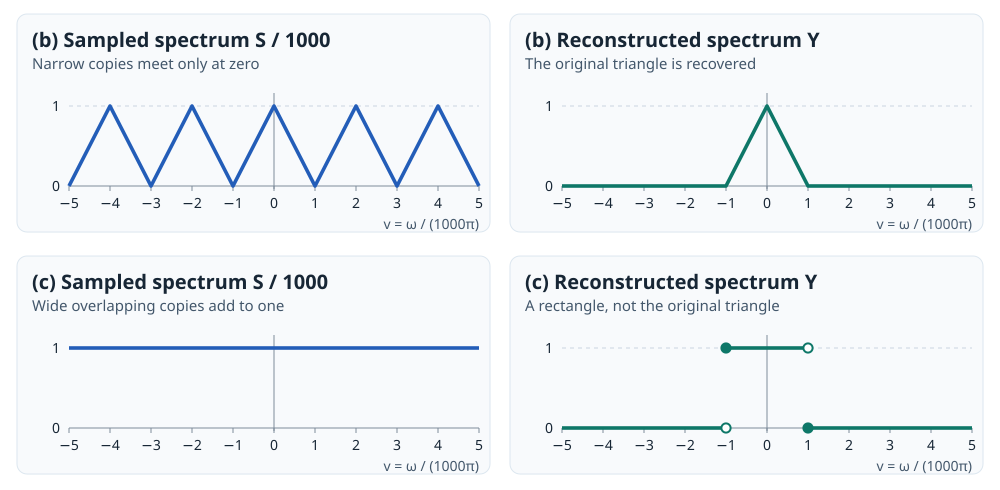

# ECE265 Tutorial 11

## Final Review: A Self-Study Guide

T02 · Ruilin Wang

This guide covers the course sequence from Chapter 1 through Chapter 12, including the complex-number tools in Appendix A. It follows the course's continuous-time/discrete-time (CT/DT) pairing, not the order in which the textbook separates the two. It is a review of course material, **not an official final-exam scope or formula sheet**. Use the [course page](https://www.ece.uvic.ca/~frodo/courses/ece265-2026-09/) and Brightspace for exam announcements.

### How to use this guide

If you are starting from scratch, follow the five modules in order. If you are stuck on a particular type of question, start with [Choose a transform](#choose-a-transform) or [Choose a system method](#choose-a-system-method). Try each short check before jumping to the [answers](#self-check-answers). The [assignment practice](#assignment-practice) is there to check your method, not to replace the explanations.

1. [Signals and systems basics](#1-signals-and-systems-basics)
2. [LTI systems and convolution](#2-lti-systems-and-convolution)
3. [Fourier series and the DFT](#3-fourier-series-and-the-dft)
4. [Fourier transforms and applications](#4-fourier-transforms-and-applications)
5. [Laplace and Z transforms](#5-laplace-and-z-transforms)

**The thread through the course:** Describe the input. Check what kind of system you have. For a linear time-invariant (LTI) system, use convolution in time or multiplication in a transform domain. Use Fourier analysis to see what happens at each frequency; use Laplace and Z to study convergence, poles and system behavior. A transform changes the representation, not the underlying signal.

Here $t$ is continuous time, $n$ is an integer sample index, $\omega$ is CT angular frequency (rad/s), and $\Omega$ is DT angular frequency (rad/sample). Some slides use $\omega$ for both; the units and context tell you which one is meant.

## 1. Signals and systems basics

### 1.1 What kind of object do I have?

A **signal** assigns a value to each time. A continuous-time (CT) signal $x(t)$ takes real-valued time $t$; a discrete-time (DT) signal $x(n)$ is indexed by integers $n$. These labels describe the time axis, not the set of possible amplitudes: a DT sequence can still have continuously valued amplitudes. A **system** takes a whole signal as its input. Write $y=\mathcal{H}\lbrace x\rbrace$ for the output signal and $y(n)$ for one of its values. A transform changes the representation, for example from time samples to frequency coefficients.

Before substituting into a formula, identify its domain and codomain. For $x(n-2)$ the argument is still an integer, while $x(n/2)$ is not automatically meaningful at odd $n$ for an integer-indexed $x$. For a composition $A(B(x))$, apply $B$ before $A$; a block diagram records that order.

**Check 1A.** Is a sequence with integer time but continuously valued amplitudes CT or DT? [Answer](#check-1a)

**References:** slides pp. 2–9, 14–25; textbook Ch. 1–2.

### 1.2 Where do complex numbers enter?

A complex number can be written as $z=a+jb=re^{j\theta}$, where $j^2=-1$, $r=\sqrt{a^2+b^2}$, and $\theta$ is an argument. Cartesian form is useful for adding; polar form is useful for multiplying (multiply the magnitudes and add the angles) or dividing (divide the magnitudes and subtract the angles). Use both the real and imaginary parts to place the angle in the correct quadrant (an inverse tangent of their ratio alone cannot always do that). For a nonzero number, the principal argument satisfies $-\pi\lt\theta\le\pi$. Conjugation gives $z^{\ast}=a-jb$ and reverses the polar angle modulo $2\pi$.

Euler's formula turns sines and cosines into complex exponentials. It is the bridge from a real waveform to its positive- and negative-frequency components:

$$
e^{j\theta}=\cos\theta+j\sin\theta,\qquad
\cos\theta=\frac{e^{j\theta}+e^{-j\theta}}{2},\qquad
\sin\theta=\frac{e^{j\theta}-e^{-j\theta}}{2j}.
$$

An analytic function is complex differentiable in a neighborhood. For a rational expression, factor first: uncancelled numerator roots are zeros and uncancelled denominator roots are poles, with multiplicities given by the remaining powers. A canceled factor is not a pole, but do not assume that the value at that point was defined in the original expression. This same bookkeeping will matter when reading a transfer function.

**Check 1B.** Is the principal argument of $-1+j$ equal to $-\pi/4$? [Answer](#check-1b)

**References:** slides pp. 360–383; textbook Appendix A.

### 1.3 How do I describe or modify a signal?

**Time versus amplitude.** The inside of $A x(at-b)+C$ changes where the signal is read; outside factors change its value. For $a\ne0$, map an old feature at $t_{\mathrm{old}}$ to the new time that solves $at-b=t_{\mathrm{old}}$. The same argument-matching approach works for DT whenever the indices are valid. A negative coefficient reverses time; CT time scaling can stretch or compress continuously. In DT, $x(Mn)$ with positive integer $M$ retains only every $M$th sample. Do not treat it as a smooth rescaling of the original graph.

**Integer endpoints.** The floor $\lfloor a\rfloor$ is the greatest integer no larger than $a$; the ceiling $\lceil a\rceil$ is the least integer no smaller than $a$. Thus $\lfloor-1.2\rfloor=-2$ and $\lceil-1.2\rceil=-1$. When a DT calculation gives a closed range $a\le n\le b$ with real endpoints, the valid integer indices run from $\lceil a\rceil$ through $\lfloor b\rfloor$, if any.

**Symmetry and periodicity.** Read $x(-\xi)$ as reflection, using $\xi=t$ or $n$. The even and odd parts are

$$
x_{\mathrm{e}}(\xi)=\frac{x(\xi)+x(-\xi)}2,\qquad
x_{\mathrm{o}}(\xi)=\frac{x(\xi)-x(-\xi)}2.
$$

Conjugate symmetry means $x(-\xi)=x^{\ast}(\xi)$; it is not just even symmetry for complex-valued signals. A period repeats the entire signal and the fundamental period is the smallest positive one, when it exists. For a nonconstant CT sinusoid of angular frequency $\omega$, it is $2\pi/\lvert\omega\rvert$. A nonzero DT complex sinusoid repeats if $N\Omega=2\pi k$ for integers $N\gt0$ and $k$, i.e. $\Omega/(2\pi)$ is rational.

**Adding periodic signals.** For two CT components with fundamental periods $T_1$ and $T_2$, look for a common period: if $T_1/T_2=p/q$ is rational in lowest terms, $qT_1=pT_2$ repeats both components and their sum. If the ratio is irrational there is no common period; in particular two nonzero sinusoids with incommensurate frequencies have an aperiodic sum. In DT, integer periods always have a least common multiple. A common period need not be the fundamental period of the sum if terms cancel.

**DT oscillation rate.** Frequencies that differ by $2\pi$ give the same sampled complex exponential. On $0\le\Omega\lt 2\pi$, the rate increases from $0$ to $\pi$ and decreases again toward $2\pi$. At $\Omega=\pi$, $e^{j\pi n}=(-1)^n$ switches sign at every sample; increasing $\Omega$ past $\pi$ does not make the sequence oscillate faster.

**Where is the signal nonzero, and how large is it?** Identify the support before applying a step or solving a convolution. Right-sided means zero sufficiently far to the left; causal means zero at all negative times. A bounded signal has a finite upper bound on its magnitude. Its 1-norm integrates or sums $\lvert x\rvert$; its energy integrates or sums $\lvert x\rvert^2$. These tests are not interchangeable: $x(n)=1$ is bounded but has infinite energy over all integers. For the course's dB convention, use $20\log_{10}(m)$ for a positive magnitude $m$ and $10\log_{10}(p)$ for a positive power $p$ (form a ratio first for a relative comparison).

**Write signals using elementary pieces.** Recognize exponentials, sinusoids, steps, rectangular pulses, sinc and impulses. Real exponential magnitude grows or decays according to its exponent (CT) or the magnitude of its base (DT); a complex exponential can also rotate. The pulse $u(t-a)-u(t-b)$ switches on at $a$ and off at $b$. For CT calculations at an isolated switch point, use the convention in the question; for DT every endpoint sample matters. A DT pulse supported on the integer interval from $a$ through $b$ is $u(n-a)-u(n-b-1)$; the extra sample in the second shift preserves the last sample at $b$.

A DT impulse $\delta(n)$ is an ordinary sequence equal to one at zero and zero elsewhere. A CT impulse $\delta(t)$ is a generalized function with unit area. Its sifting and scaling rules are

$$
\int_{-\infty}^{\infty}x(t)\delta(t-t_0)\thinspace dt=x(t_0),\qquad
\delta(at)=\frac{1}{\lvert a\rvert}\delta(t)\quad(a\ne0)
$$

for an input suitable for the sifting operation. In DT, $\sum_n x(n)\delta(n-n_0)=x(n_0)$ instead; $\delta(Mn)=\delta(n)$ for any nonzero integer $M$.

**Check 1C.** Where is the feature originally at $t=5$ in $x(2t-1)$? What is its new value relative to the original? [Answer](#check-1c)

**Practice:** [Assignment 2A, 3.17(c)](#practice-317c) combines causality with even-part decomposition.

**References:** slides pp. 27–45 and 47–102; textbook Ch. 3 and 8, plus Ch. 2 for norms and dB.

### 1.4 How do I check the properties of an arbitrary system?

If the problem gives an input-output rule rather than an LTI impulse response, start with the definitions. At an output time $\xi_0$, compare how the rule behaves on the input values indicated below.

| Property | What to check |
| --- | --- |
| Linear | Test the output for an arbitrary linear combination against the same combination of the individual outputs. A nonzero response to zero input disproves linearity; a zero response alone does not prove it. |
| Time-invariant | Compare **shift the input, then apply the system** with **apply the system, then shift the output**. Use an arbitrary input and shift or give a counterexample. |
| Causal | Two inputs that agree up to and including $\xi_0$ must give the same output at $\xi_0$. A dependency on a future value can violate this. |
| Memoryless | Agreement at just $\xi_0$ must suffice for equal output there. A delay can be causal but still have memory. |
| Invertible | Can the full input be recovered uniquely from the full output on the stated input class? Two distinct inputs with identical outputs disprove invertibility. |
| BIBO stable | Every bounded input must give a bounded output over all time. If the rule contains sums or integrals over growing intervals, check whether their size can grow without bound. |

A proof must cover the allowed inputs and time indices. A counterexample only needs one case for which the required condition fails. An **eigensignal** is a nonzero input whose output is one scalar times that same whole signal; the scalar cannot vary with time.

**Check 1D.** Is $y(n)=n x(n)$ linear, time-invariant, and BIBO stable? [Answer](#check-1d)

**References:** slides pp. 105–121; textbook Ch. 3 and 8.

## 2. LTI systems and convolution

### 2.1 What is convolution actually accumulating?

Convolution multiplies one signal by a reversed and shifted version of the other, then accumulates the product. In CT the accumulation is an integral; in DT it is a sum:

$$
(x\ast h)(t)=\int_{-\infty}^{\infty}x(\tau)h(t-\tau)\thinspace d\tau,\qquad
(x\ast h)(n)=\sum_{k=-\infty}^{\infty}x(k)h(n-k).
$$

Read $t$ or $n$ as fixed while you integrate in $\tau$ or sum over $k$. For each output time, find where **both** factors are nonzero. For example, if $x(\tau)$ is supported on $[a,b]$ and $h$ on $[c,d]$, the second factor is supported in $\tau$ on $[t-d,t-c]$. Intersect this with $[a,b]$ before integrating. New pieces of the answer occur where endpoints meet. In DT you can use the same method with integer endpoints, or a table of products grouped by the sum of the input indices. For finite DT sequences of lengths $L_x$ and $L_h$ starting at $n_x$ and $n_h$, the full convolution has $L_x+L_h-1$ slots starting at $n_x+n_h$. Some entries may be zero; the span is not a claim that every entry is nonzero.

Convolution is commutative, associative and distributive under the usual existence conditions. The impulse is the identity, and convolving with a shifted impulse shifts the signal: $(x\ast\delta_{\mathrm{shifted}})(n)=x(n-m)$ when $\delta_{\mathrm{shifted}}(n)=\delta(n-m)$ (with the analogous CT result). That is often much faster than setting up an integral.

**Check 2A.** If two finite sequences start at $-2$ and $3$, what index belongs to the first entry returned by MATLAB's full convolution? [Answer](#check-2a)

**References:** slides pp. 126–130; textbook Ch. 4 and 9, convolution sections.

### 2.2 Why is the impulse response enough to characterize an LTI system?

An input can be viewed as a weighted collection of shifted impulses. In DT the decomposition is $x(n)=\sum_k x(k)\delta(n-k)$; the CT version integrates $x(\tau)\delta(t-\tau)$ over $\tau$. If a system is linear and time-invariant, the response to each shifted impulse is the same shift of its response $h$ to the original impulse. Linearity adds those responses with their original weights, giving $y=x\ast h$. This argument explains both the convolution formula and why it does not characterize an arbitrary nonlinear or time-varying system.

Find $h$ by sending $\delta$ into the system. The **step response** is the output for input $u$, so for an LTI system it is $u\ast h$. Neither is the output for an arbitrary $x$ unless that is the specified input.

**Check 2B.** If an LTI system gives $h(t)$ for a unit impulse, what is the response to $2\delta(t-3)$? [Answer](#check-2b)

**References:** slides pp. 123–126, 132–134; textbook Ch. 4 and 9, LTI characterization.

### 2.3 How do LTI blocks combine, and what can I read from their responses?

**Cascade:** The first output is $x\ast h_1$. Convolving that with $h_2$ gives $x\ast(h_1\ast h_2)$, so the equivalent response is $h_1\ast h_2$. **Parallel with summed outputs:** Both blocks see the same $x$; use distributivity to get $h_1+h_2$. When reading a diagram, distinguish a branch sum from one block feeding another.

- **Causal:** $h$ vanishes at negative time.
- **Memoryless:** $h=K\delta$ for a constant $K$; it scales the current input without looking elsewhere.
- **Invertible:** Look for an inverse response $h_{\mathrm{inv}}$ satisfying $h\ast h_{\mathrm{inv}}=\delta$ on the stated signal class. Invertibility alone does not guarantee a causal or stable inverse.
- **BIBO stable:** For ordinary CT $h$, check $\int_{-\infty}^{\infty}\lvert h(t)\rvert\thinspace dt\lt\infty$; in DT, check $\sum_n\lvert h(n)\rvert\lt\infty$. If a CT response also has finitely many terms $c_i\delta(t-t_i)$ at distinct times, add $\sum_i\lvert c_i\rvert$ to the integral of the ordinary part: each impulse just contributes one scaled, shifted copy of the input.

When the defining integral or sum for the eigenvalue converges, $e^{st}$ through a CT LTI system gives $H(s)e^{st}$, and $z^n$ with $z\ne 0$ through a DT LTI system gives $H(z)z^n$. The factors come from integrating $h(\tau)e^{-s\tau}$ or summing $h(k)z^{-k}$. They are values of the **system function** (see §5.3). When the imaginary axis or unit circle lies in its region of convergence, $s=j\omega$ and $z=e^{j\Omega}$ give the **frequency-response** special cases. This is why we can decompose the input into frequency components and apply one complex factor to each.

**Check 2C.** Is $h(n)=\delta(n-1)$ causal and stable? Is it memoryless? [Answer](#check-2c)

**Practice:** [Assignment 3B, 4.13(b)](#practice-413b) starts with a cascade and uses the equivalent impulse response to obtain the output.

**References:** slides pp. 134–142; textbook Ch. 4 and 9, LTI interconnections, properties and eigenfunctions.

## 3. Fourier series and the DFT

### 3.1 Which harmonics make up a periodic signal?

A periodic signal repeats one pattern. Fourier analysis describes that pattern using harmonically related complex sinusoids. An **analysis** equation finds their weights; a **synthesis** equation adds the weighted sinusoids back together. Here $a_k$ is the coefficient of harmonic $k$ (also written $c_k$ in the textbook).

**CT:** Find a period $T$, set $\omega_0=2\pi/T$ (rad/s), and integrate over one full period, starting at any convenient $t_0$.

$$
a_k=\frac{1}{T}\int_{t_0}^{t_0+T}x(t)e^{-jk\omega_0t}\thinspace dt,
\qquad
x(t)=\sum_{k=-\infty}^{\infty}a_ke^{jk\omega_0t}.
$$

**DT:** Find an integer period $N$, set $\Omega_0=2\pi/N$ (rad/sample), and sum over one full set of $N$ consecutive indices.

$$
a_k=\frac{1}{N}\sum_{n=0}^{N-1}x(n)e^{-jk\Omega_0 n},
\qquad
x(n)=\sum_{k=0}^{N-1}a_ke^{jk\Omega_0 n}.
$$

In DT, increasing $k$ by $N$ changes the exponential by a factor $e^{j2\pi n}=1$, so $a_{k+N}=a_k$ and the synthesis uses only $N$ distinct harmonic indices. CT coefficients do not generally repeat. The two endpoints of a DT interval from $0$ through $N$ would give $N+1$ samples; do not double-count the endpoint.

**How to work a problem.** If the signal is already a sum of sinusoids, first expand each sine or cosine with Euler's identities and match exponents on a common harmonic grid. Otherwise, use the analysis equation and split at changes in the signal's formula. Linearity lets you calculate one component at a time **on a common period**.

**Read the result.** The spectrum places $a_k$ at angular frequency $k\omega_0$ (CT) or $k\Omega_0$ (DT). Magnitude is $\lvert a_k\rvert$ and phase is $\arg(a_k)$. A zero coefficient carries no phase information; the textbook uses $\arg 0=0$ for plotting (Example 5.9, p. 149). Check $a_0$ against the average over one period. Even/odd signals give even/odd coefficient sequences; a real signal gives $a_{-k}=a_k^{\ast}$. In DT, DC and, for even $N$, $k=N/2$ are their own conjugate partners, so their coefficients are real for real input.

**Check 3A.** If $a_2=3j$ for a real CT signal, is the coefficient at $-2$ also $3j$? [Answer](#check-3a)

**References:** slides pp. 146–155 and 163–171; textbook §§5.2–5.3, 5.5–5.6, 10.2–10.3, 10.5 and 10.7.

### 3.2 Why are the DTFS and DFT not the same array?

The **DTFS** describes an $N$-periodic sequence through a coefficient sequence (itself periodic); the **DFT** takes an $N$-element vector to another $N$-element vector. With the course convention, the DFT puts no $1/N$ in the forward sum and puts $1/N$ in the inverse:

$$
X_{\mathrm{DFT}}(k)=\sum_{n=0}^{N-1}x(n)e^{-j2\pi kn/N},
\qquad
x(n)=\frac{1}{N}\sum_{k=0}^{N-1}X_{\mathrm{DFT}}(k)e^{j2\pi kn/N}.
$$

If this vector is exactly the periodic signal's samples at $n=0,\ldots,N-1$, the sums are the same as in §3.1 except for scaling:

$$
X_{\mathrm{DFT}}(k)=Na_k,\qquad k=0,\ldots,N-1.
$$

This relation assumes the same origin. Moving the start of the period to a different index and feeding the values to a DFT as positions starting at zero introduces a phase shift. A frequency indexed by $k=-1$ is represented by $k=N-1$, since the DT frequency changes by $2\pi$. Physical frequency and array position are different labels: math bin $k$ is MATLAB position $k+1$.

**Check 3B.** An eight-sample vector represents one aligned period of a DT signal. If its DFT gives $X_{\mathrm{DFT}}(7)=8j$, what is $a_{-1}$? [Answer](#check-3b)

**Practice:** [10.11(b), DTFS to DFT](#practice-1011b).

**References:** slides pp. 157–161 and 168–171; textbook §§10.6–10.7; MATLAB's `fft` uses the no-$1/N$ forward convention here.

## 4. Fourier transforms and applications

### 4.1 How does a continuous frequency variable enter the picture?

Fourier series uses a grid of harmonics spaced by the fundamental angular frequency. Making a period longer moves those harmonics closer together. A Fourier transform describes a general signal using a **continuous frequency variable**, even when the signal itself is discrete in time.

**CTFT** of $x(t)$ and the inverse:

$$
X(\omega)=\int_{-\infty}^{\infty}x(t)e^{-j\omega t}\thinspace dt,
\qquad
x(t)=\frac{1}{2\pi}\int_{-\infty}^{\infty}X(\omega)e^{j\omega t}\thinspace d\omega.
$$

**DTFT** of $x(n)$ and the inverse:

$$
X(\Omega)=\sum_{n=-\infty}^{\infty} x(n)e^{-j\Omega n},
\qquad
x(n)=\frac{1}{2\pi}\int_{-\pi}^{\pi}X(\Omega)e^{j\Omega n}\thinspace d\Omega.
$$

Use radians per second for $\omega$ and radians per sample for $\Omega$. The slides often write $\omega$ for both. The DTFT repeats every $2\pi$, again because $e^{-j2\pi n}=1$; integrate over one such interval. The CTFT does not generally repeat. For a real signal $X(-\nu)=X^{\ast}(\nu)$, where $\nu$ stands for the relevant frequency variable.

**Bandwidth** is the width of the smallest interval containing the occupied spectrum, using the full frequency axis for CT and one baseband period $(-\pi,\pi]$ for DT. For a real signal, we often report a one-sided bandwidth instead: support from $-B$ to $B$ has width $2B$ on both sides combined, or $B$ on the nonnegative side. State which convention and units you are using.

**Periodic signals are not excluded from the FT.** A periodic signal's ordinary integral or sum above need not converge; the generalized transform represents its harmonics as Dirac impulses. With the course normalization the impulse at harmonic $k$ has **weight** $2\pi a_k$, not height $a_k$. In DT, the impulses repeat with the spectrum. Conversely, cut out one period and zero the signal elsewhere; sampling this truncated signal's transform at the harmonics and dividing by $T$ (CT) or $N$ (DT) gives the FS coefficients.

**Finite duration is not finite bandwidth.** A nonzero signal cannot be both exactly time-limited and bandlimited. A finite DT sequence gives a finite sum of exponentials as a function of frequency; it does not give a frequency function confined to a strict subinterval of one period. A finite plotted or measured range is not itself evidence of bandlimiting.

**Check 4A.** Is the DTFT of $x(n)=\delta(n-2)$ itself a vector with finitely many entries? [Answer](#check-4a)

**References:** slides pp. 177–185 and 218–227; textbook §§6.2–6.5, 6.8, 6.10–6.11, 11.2–11.5, 11.8 and 11.10–11.11.

### 4.2 How do I pick a transform property instead of starting over?

First name a base signal with a known transform. Write how the given signal is formed: for instance, scale the argument, then shift, then add another term. Apply the corresponding transform rule in the **same order**. For piecewise or composite expressions, split into simpler terms first and combine using linearity. If you cannot recognize useful terms, use the definition.

Use $\xi$ for time or the sample index and $\nu$ for the matching angular frequency. These rules answer different questions:

| You do this to the signal | You do this to its spectrum |
| --- | --- |
| Delay: $x(\xi-d)$ | Multiply by $e^{-j\nu d}$. No magnitude change. |
| Modulate: $e^{j\nu_c\xi}x(\xi)$ | Shift to $X(\nu-\nu_c)$. |
| Reverse: $x(-\xi)$ | Reverse to $X(-\nu)$. |
| Conjugate: $x^{\ast}(\xi)$ | Conjugate **and** reverse: $X^{\ast}(-\nu)$. |
| Convolve: $(x_1\ast x_2)(\xi)$ | Multiply: $X_1(\nu)X_2(\nu)$. |
| Multiply: $x_1(\xi)x_2(\xi)$ | Convolve the spectra and multiply by $1/(2\pi)$; in DT the convolution is periodic over $2\pi$. |
| Weight by time/index: $\xi x(\xi)$ | Differentiate the spectrum: $j\thinspace dX/d\nu$. |

In DT, the shift $d$ is an integer and frequency shifts wrap around in a $2\pi$ interval. **Do not use CT dilation as a DT rule.** In CT, for real $a\ne0$, $x(at)$ gives $X(\omega/a)/\lvert a\rvert$. CTFT duality gives $X(t)\leftrightarrow 2\pi x(-\omega)$; note both the reversal and the factor. CT time-domain differentiation gives $j\omega X(\omega)$, which is different from differentiating $X$ with respect to frequency. Under the conditions of the course's integration rule, a CT running integral from $-\infty$ has a generalized transform with both the $X(\omega)/(j\omega)$ term and the DC term $\pi X(0)\delta(\omega)$. Do not treat it as ordinary pointwise division at DC.

**Check with structure.** Even/odd symmetry is preserved; a real input gives conjugate symmetry, and a conjugate-symmetric input gives a real transform. For a real input, magnitude is even and phase is odd modulo $2\pi$ wherever the spectrum is nonzero. A real even input gives a real even transform, while a real odd input gives a purely imaginary odd transform. For finite-energy signals, Parseval's relation equates time-domain energy with $1/(2\pi)$ times the integral of $\lvert X\rvert^2$: integrate over the whole real frequency line for CT or over one $2\pi$ period for DT. This is a check on scaling, not a method for reading phase.

**Check 4B.** Suppose $v(t)=e^{j\omega_c t}x(t-2)$. Do we get $e^{-j2\omega}X(\omega-\omega_c)$? [Answer](#check-4b)

**References:** slides pp. 187–210 and 215–216; textbook §§6.7 and 11.7 for pairs and properties.

### 4.3 How do I use a frequency response to predict the output?

The time-domain relation $y=x\ast h$ becomes $Y=HX$, with $H$ the transform of the impulse response. At a frequency where the response is defined, it multiplies a sinusoidal input component by a complex gain. Its magnitude sets the amplitude change and its argument adds phase.

1. **Find $H$.** Transform the impulse response if it is given. If you have a constant-coefficient equation, transform each term, collect the $Y$ and $X$ factors, and solve for the response. A CT derivative gives $j\omega$; a DT sample delay by $m$ gives $e^{-jm\Omega}$. To reverse a DT conversion, cross-multiply, then turn each exponential factor back into the corresponding delay or advance.
2. **Combine or apply $H$.** For LTI blocks in series multiply responses; for additive parallel branches sum them. For a periodic input, evaluate at each harmonic and multiply its FS coefficient by the corresponding complex value. For a general spectrum, form $Y=HX$ and take the inverse as needed. Do not compute a response by dividing measured $Y$ by $X$ at a spectral zero of the input.
3. **Interpret the spectrum.** An ideal lowpass, highpass, bandpass or bandstop filter changes different frequency bands. Draw the passband(s) and multiply by the actual passband gain, not always one. Extend DT responses periodically. A zero gain removes the component; the phase at that zero carries no information.

**AM connects modulation to filtering.** Multiplying by a complex sinusoid shifts the spectrum once. Multiplying by a cosine creates the two shifted copies $\tfrac12 X(\nu-\nu_c)+\tfrac12 X(\nu+\nu_c)$. In double-sideband suppressed-carrier (DSB-SC) AM, a second multiplication by a matching cosine gives

$$
V(\nu)=\frac12X(\nu)+\frac14 X(\nu-2\nu_c)+\frac14 X(\nu+2\nu_c).
$$

A lowpass of gain two restores the baseband if the shifted copies are separated from it. The multiplier and the lowpass are **different** operations: multiplication in time shifts and combines spectra; an LTI filter multiplies by $H$. For DT, draw the copies modulo $2\pi$ before checking separation.

**Check 4C.** An LTI system is a pure delay by two samples. Can you detect it by plotting the input and output magnitudes only? [Answer](#check-4c)

**References:** slides pp. 173–175, 229–239 and 241–267; textbook §§5.7, 6.13–6.16, 6.19, 10.8 and 11.13–11.16.

### 4.4 What is being sampled: a spectrum or a waveform?

**Frequency samples of a DTFT.** For a finite sequence supported in $0,\ldots,M-1$, take the $N$-point DFT with $N\ge M$ (zero-pad when needed). Then

$$
X_{\mathrm{DFT}}(k)=X(2\pi k/N),\qquad k=0,\ldots,N-1.
$$

The right side is the DTFT of the original finite sequence evaluated at a grid of frequencies. Increasing $N$ by zero-padding gives more grid points; it does not supply more observed signal or change that DTFT. This is not the same operation as sampling a CT waveform.

**Time samples of a CT waveform.** With sample spacing $T_s$, record $y(n)=x(nT_s)$, let $f_s=1/T_s$ (Hz) and $\omega_s=2\pi f_s$. To see what sampling does, model those samples as an impulse train weighted by $y(n)$. Its spectrum is

$$
S(\omega)=\frac{1}{T_s}\sum_{m=-\infty}^{\infty}X(\omega-m\omega_s).
$$

Each replica comes from one harmonic of the sampling impulse train: its Fourier series coefficients are all $1/T_s$, and the harmonics are spaced by $\omega_s$. Where replicas overlap, their values **add**; this is aliasing. When the replicas do not overlap, ideal lowpass reconstruction isolates the central copy and compensates for its scale with passband gain $T_s$ (equivalently, sinc interpolation).

**Background: comparing the two spectra.** $S(\omega)$ is the CTFT of the weighted impulse train, not the DTFT $Y(\Omega)$ of the sample sequence. Their frequency axes satisfy $S(\omega)=Y(\omega T_s)$; this follows by substituting the weighted impulses into the CTFT. See slide p. 284 and textbook §11.18.

**How to check a sampling problem.** Draw the original support, mark its shifted copies, then mark what the reconstruction filter passes. Keep Hz and rad/s consistent on that axis. If the input is bandlimited to $\lvert f\rvert\le B$, $f_s\gt 2B$ is sufficient for perfect ideal reconstruction. Here $B$ is the largest occupied absolute frequency in Hz, not an arbitrary passband width. The **Nyquist rate** is $2B$ for this signal, and the **Nyquist frequency** is $f_s/2$ for this sampler. Do not treat equality as an unconditional guarantee; check the spectra at the boundary. If you must prevent overlap, an analog anti-alias filter goes **before** sampling; a lowpass after sampling cannot undo energy that has already folded into the kept band.

**Check 4D.** At $f_s=10$ kHz, could $7$ kHz and $3$ kHz zero-phase cosines produce the same samples? [Answer](#check-4d)

**Practice:** [6.26(b,c), sampling and reconstruction](#practice-626bc).

**References:** slides pp. 269–281 and 285–290; textbook §§6.20 and 11.19.

From here, ask what happens when an ordinary Fourier transform does not converge or when the system has nonzero initial conditions. Those questions motivate Laplace and Z transforms in the next module.

## 5. Laplace and Z transforms

### 5.1 Why add a convergence factor?

Fourier analysis uses complex exponentials that oscillate without decay. An ordinary Fourier transform may not converge for a growing signal. The Laplace kernel uses $s=\sigma+j\omega$, so $e^{-st}=e^{-\sigma t}e^{-j\omega t}$ gives a way to weight the signal before measuring its oscillation. The Z transform does the same for sequences: for $z=re^{j\Omega}$, $z^{-n}=r^{-n}e^{-j\Omega n}$.

The **bilateral** transforms use all time. The **unilateral** transforms use nonnegative time, with the CT convention starting just before zero so that an impulse at the origin is included:

$$
X_{\mathrm{L}}(s)=\int_{-\infty}^{\infty}x(t)e^{-st}\thinspace dt,
\qquad
X_{\mathrm{Z}}(z)=\sum_{n=-\infty}^{\infty}x(n)z^{-n}.
$$

$$
X_{\mathrm{L}+}(s)=\int_{0^-}^{\infty}x(t)e^{-st}\thinspace dt,
\qquad
X_{\mathrm{Z}+}(z)=\sum_{n=0}^{\infty}x(n)z^{-n}.
$$

The **region of convergence (ROC)** is the set where the defining integral or sum converges. The unilateral ROC is a right half-plane or the whole plane in CT, and a circle exterior or the whole plane in DT, if it is nonempty. To recover the ordinary CTFT by setting $s=j\omega$, check that the imaginary axis is in the bilateral ROC. To recover the ordinary DTFT by setting $z=e^{j\Omega}$, check the unit circle instead. If the needed locus is not in the ROC, do not simply substitute and call the result a Fourier transform; generalized Fourier transforms are a separate issue.

An inverse unilateral transform only recovers the part on its one-sided domain. Reconstruct the negative-time part as zero only if causality is given or explicitly assumed.

**Check 5A.** For the causal unit step $u(t)$, both the ULT and BLT give $1/s$, with ROC $\mathrm{Re}(s)\gt 0$. Can you obtain its ordinary CTFT by substituting $s=j\omega$? [Answer](#check-5a)

**Optional textbook background: why a bilateral inverse also needs the ROC.** Look at these two sequences for real $a$ with $0\lt a\lt 1$:

| DT sequence | Bilateral Z transform | ROC |
| --- | --- | --- |
| $a^n u(n)$ | $1/(1-az^{-1})$ | Outside the circle of radius $a$ |
| $-a^n u(-n-1)$ | $1/(1-az^{-1})$ | Inside the circle of radius $a$ |

The expressions match, but one series is summed over nonnegative indices and the other over negative indices. Their ROCs differ, so the algebra alone does not determine the bilateral inverse. In CT, right- and left-sided exponentials likewise converge on opposite sides of a vertical line. See textbook §§7.7 and 12.7.

**References:** textbook §§7.3–7.7, 12.3–12.7, 7.17 and 12.16; slides pp. 292–311.

### 5.2 How do I go from the signal to the transform and back? (6A)

Start with the definition if the problem asks for it. For an elementary causal exponential, the ULT is an exponential integral and the UZT is a geometric sum:

$$
e^{-at}u(t)\ \longleftrightarrow\ \frac{1}{s+a}
\quad\text{for real }a,\ \mathrm{Re}(s)\gt-a.
$$

$$
a^n u(n)\ \longleftrightarrow\ \frac{1}{1-az^{-1}}
\quad\text{for real }a\ne 0,\ \lvert z\rvert\gt\lvert a\rvert.
$$

When using tables, first put the signal in a form that matches a known pair. For a piecewise signal, express changes as delayed causal pieces. For example, a pulse that is $1$ from $t=2$ up to $t=5$ can be written $u(t-2)-u(t-5)$. The ULT is $(e^{-2s}-e^{-5s})/s$; the apparent pole at $s=0$ is removable, as you can also see by integrating over the finite interval. In ROC questions, check the **final** result: a bound obtained from separate terms need not be exact when they cancel.

| Operation | How to use it |
| --- | --- |
| Linearity | Transform the pieces and take the same linear combination; recheck the ROC if terms cancel. |
| Causal delay | A delay by $t_0\ge 0$ gives $e^{-st_0}$ in CT; a delay by $m\ge 0$ integer samples gives $z^{-m}$ in DT. These simple unilateral rules assume a causal source. |
| Convolution of causal signals | Multiply the unilateral transforms under the usual convergence assumptions. |
| Shifting or rescaling the transform argument | Multiplying by $e^{at}$ replaces $s$ with $s-a$; multiplying by $b^n$ for $b\ne 0$ replaces $z$ with $z/b$. Positive CT time scaling by $a$ gives $X(s/a)/a$. |
| Time multiplying the signal | Within the domain where termwise differentiation is valid, $t x(t)$ gives $-dX/ds$ and $n x(n)$ gives $-z\thinspace dX/dz$; use the same transform convention throughout. |
| CT time differentiation/integration | Differentiation gives $sX(s)-x(0^-)$ for the first derivative. A causal running integral from zero gives $X(s)/s$ where convergent. |

For an **inverse**, the course's partial-fraction procedure works with a proper rational transform: after removing any specified delay factor, the numerator degree does not exceed the denominator degree (in $s$ or $z$). Use this order:

1. Put the expression in the form required for partial fractions. In CT, take out any explicit delay. If the remaining transform is proper but not strictly proper, use division to write it as $K+X'(s)$, with $X'$ strictly proper. A constant transform $K$ inverts to $K\delta(t)$ in CT or $K\delta(n)$ in DT. In DT, the course method works directly with a proper $X(z)$, including any constant contribution: divide by $z$ first so $X(z)/z$ is strictly proper.
2. Factor the denominator of the strictly proper expression. A simple pole needs one term; a repeated pole of order two needs terms with that factor to powers one and two. For example, $1/(s+2)^2$ inverts to $t e^{-2t}u(t)$, not another copy of $e^{-2t}u(t)$.
3. Match each term to the exact table form. In DT, if $1/(z-a)$ is a partial-fraction term of $X(z)/z$, multiply it back by $z$ before inversion: $z/(z-a)$ corresponds to $a^n u(n)$. If $1/(z-a)$ is a term of $X(z)$ itself, it is $z^{-1}$ times $z/(z-a)$, so its inverse includes a one-sample delay. In CT, apply $e^{-st_0}$ as a delay after inverting the rest.
4. Check the initial sample, the onset time and the support. If in doubt, transform your answer back.

**Check 5B.** For $a=1/2$, where does the sequence corresponding to $1/(z-a)$ start, and what is its first nonzero sample? [Answer](#check-5b)

**Practice:** [7.31(b), repeated-pole inversion](#practice-731b).

**References:** textbook §§7.10, 7.17, 12.10 and 12.16, and Appendix B (pp. 673–677); slides pp. 312–342 and 385–394 for partial-fraction techniques.

### 5.3 How do equations, system functions and poles fit together? (6B)

A system function is the transform of the impulse response. For a causal LTI system it describes the **zero-state** relationship between input and output: with zero initial conditions, $Y=HX$ in the appropriate transform domain. Keep unilateral initial terms if the question asks for the total response from a nonzero initial state.

| Start with | What to do |
| --- | --- |
| CT differential equation | Transform each derivative, collect terms multiplying $Y(s)$ and $X(s)$, then form the ratio for the zero-state system. For example, $y'(t)+2y(t)=x(t)$ gives $(s+2)Y(s)=X(s)+y(0^-)$. The system function is $1/(s+2)$; the initial-value term contributes separately to $Y$. |
| DT difference equation | With zero past initial values, each delay gives one factor of $z^{-1}$. For example, $y(n)-\frac12 y(n-1)=x(n)$ gives $H(z)=1/(1-\frac12 z^{-1})$. If the initial value is not zero, the UZT of $y(n-1)$ is $z^{-1}Y(z)+y(-1)$, so retain the extra term. |
| A system function | Cross-multiply before inverting. Read powers of $s$ as derivatives in the zero-state equation; read factors $z^{-m}$ as delays. If using nonzero initial conditions to solve the equation, put those terms back when you transform it. |
| A block diagram | Multiply system functions in cascade and add them for branches summed in parallel. Keep track of subtraction signs at summing nodes. |

Causality and stability answer different questions:

- **Causality:** is $h$ zero before the origin? For a causal rational system with at least one finite pole, the ROC is right of the rightmost pole in CT, or outside the outermost pole circle in DT (including $z=\infty$). Using the ULT or UZT of $h$ as the **complete** system function assumes that $h$ is causal; use the bilateral transform for a noncausal response.
- **BIBO stability:** is $h$ absolutely integrable/summable (including the finite contribution of any pure impulse/direct term)? For the bilateral system function, the ROC must contain the imaginary axis in CT or the unit circle in DT. For a **causal system with a proper rational CT system function**, all actual poles must be strictly in the left half-plane. For a **causal rational DT system**, they must be strictly inside the unit circle. Cancel common factors before calling a denominator root a pole; without causality, check the ROC rather than using these causal pole tests.
- **Invertibility:** an LTI inverse would satisfy $H_{\mathrm{inv}}H=1$ where both representations apply. Check that the proposed inverse exists for the signal class in the question; a formal reciprocal is not by itself proof of a causal, stable inverse.

**Check 5C.** A causal rational DT system has one actual pole at $z=1$. Its other poles are inside the unit circle. Is it BIBO stable? [Answer](#check-5c)

**Practice:** [12.19(b), block diagram and stability](#practice-1219b).

**References:** textbook §§7.11–7.14, 7.18, 12.11–12.14 and 12.17; slides pp. 344–354.

### 5.4 Feedback and MATLAB applications

Use this as a course-end connection if feedback has been covered in lecture. In a negative-feedback loop with forward block $G$ and feedback block $F$, the forward input is $X-FY$, so $Y=G(X-FY)$. Solve this equation to get $H_{\mathrm{closed}}=G/(1+GF)$ and then analyze the **closed-loop** system. The feedback sign comes from the summing junction. Stable individual blocks do not, by themselves, prove closed-loop stability.

**MATLAB reference for self-study.** Use element-wise operators such as `.*`, `./` and `.^` when a formula acts independently on each array entry. Use `freqs` for CT frequency responses in rad/s and `freqz` for DT responses (check the units returned by the calling form). In a MATLAB filter-design interface that normalizes Nyquist to $1$, use $f/(f_s/2)$ for a target in Hz; this is not a rad/sample value. Symbolic `laplace` / `ilaplace` and `ztrans` / `iztrans` can check a table calculation. Confirm the assumed time/index origin instead of treating symbolic output as a substitute for a derivation. Pole and step-response plots help you compare systems; a finite plot does not replace a stability argument. This is a reference, not a claim about the MATLAB scope of the final.

**References:** textbook §§7.16, 12.15, D.7 and D.15, including §D.15.2.1 (p. 720); slides pp. 355–358; [lecture schedule](https://www.ece.uvic.ca/~frodo/courses/ece265-2026-09/lecture_schedule/) for the course-end feedback topic.

## Self-check answers

### Check 1A

DT. The time axis, not the amplitude values, decides.

### Check 1B

No. It is in quadrant II, so the argument is $3\pi/4$.

### Check 1C

$2t-1=5$ gives $t=3$. The value does not change because there is no outside amplitude operation.

### Check 1D

It is linear. A one-sample shift before versus after it produces factors $n$ and $n-1$, so it is not time-invariant. The bounded input $x(n)=1$ gives an unbounded output, so it is not BIBO stable.

### Check 2A

$-2+3=1$. MATLAB's conv returns the values, not their physical time indices, so track the origin separately.

### Check 2B

$2h(t-3)$, by linearity and time invariance, respectively.

### Check 2C

Causal and stable (only a sample of magnitude one at $n=1$), but not memoryless: it returns $x(n-1)$.

### Check 3A

No: it is $-3j$. Together these two terms make a real-valued sinusoid.

### Check 3B

$a_{-1}=a_7=(8j)/8=j$.

### Check 4A

No. It is the continuous, $2\pi$-periodic frequency function $e^{-j2\Omega}$; a DFT would evaluate it at finitely many equally spaced frequencies for a sufficient record containing the impulse.

### Check 4B

No. Delay first to get $e^{-j2\omega}X(\omega)$, then shift the *whole* spectrum to get $e^{-j2(\omega-\omega_c)}X(\omega-\omega_c)$.

### Check 4C

No. $H(\Omega)=e^{-j2\Omega}$ has magnitude one everywhere. The phase reveals the delay.

### Check 4D

Yes. Their angles at sample $n$ differ by replacing $2\pi(3/10)n$ with $2\pi n-2\pi(3/10)n$, which gives the same cosine.

### Check 5A

No. The unit step has no ordinary CTFT because its Fourier integral does not converge. Substituting $s=j\omega$ puts $s$ on the imaginary axis, outside the Laplace ROC $\mathrm{Re}(s)\gt 0$. The **generalized** CTFT is $\pi\delta(\omega)+1/(j\omega)$, with the reciprocal interpreted in the generalized sense. Simply substituting into $1/s$ misses the impulse at DC. See textbook Example 6.18 (p. 187).

### Check 5B

It is $a^{n-1}u(n-1)$, so it starts at $n=1$ with value $1$. The extra $z^{-1}$ is a delay compared with $1/(1-az^{-1})$.

### Check 5C

No. Causality requires the ROC to extend strictly outside the outermost pole. Because the unit circle touches a pole, it is not contained in the ROC.

## Assignment practice

These are references to the original assigned subparts in Michael D. Adams, *Signals and Systems*, 7.0.0-beta.3. The descriptions below are paraphrases; consult the textbook for the original wording. Try each question, use its first-step hint if needed, and then follow the link to the worked solution.

### Practice 3.17(c)

**Assignment 2A · textbook p. 72.** A causal signal $x$ has even part $x_{\mathrm{e}}(t)=t[u(t)-u(t-1)]+u(t-1)$ for $t\ge 0$. Recover $x(t)$ for all $t$.

**First step:** For $t\gt 0$, decide what causality tells you about $x(-t)$. Treat the origin separately. [Worked solution](#solution-317c)

### Practice 4.13(b)

**Assignment 3B · textbook p. 117.** Two CT LTI systems in cascade each have impulse response $\delta(t+1)$. Find the output of the cascade to a unit step $u(t)$.

**First step:** Compute the equivalent impulse response or track the shift one block at a time. Is $t+1$ an advance or a delay? [Worked solution](#solution-413b)

### Practice 10.11(b)

**Assignment 4 · textbook p. 480.** The DTFS coefficient sequence has period $4$ and the ordered values $(a_{-2},a_{-1},a_0,a_1)=(12,6+4j,-4,6-4j)$. Find the unnormalized 4-point DFT of the samples ordered at $n=0,1,2,3$.

**First step:** Move each coefficient to an index in $0,1,2,3$ before applying the DFT normalization. [Worked solution](#solution-1011b)

### Practice 6.26(b,c)

**Assignment 5B · textbook p. 248.** A CT signal is sampled by multiplying it by an impulse train of period $T_s=1/1000$ s. The sampled signal then passes through the reconstruction filter $H(\omega)=\tfrac{1}{1000}\mathrm{rect}(\omega/(2000\pi))$. In (b), the unit-height input triangle $X_1$ is centered at zero and reaches zero at $\pm1000\pi$ rad/s. In (c), the unit-height triangle $X_2$ reaches zero at $\pm2000\pi$ rad/s. For each input, plot the sampled spectrum $S$ and reconstructed spectrum $Y$, and compare $y$ with $x$.

**First step:** Read $T_s$ and calculate copy spacing in rad/s. Mark the support of the original and each nearby copy. Add contributions where they overlap, then apply the reconstruction filter, keeping the sampler scale separate from the filter gain. [Worked solution](#solution-626bc)

### Practice 7.31(b)

**Assignment 6A · textbook p. 340.** Find the inverse unilateral Laplace transform of $X(s)=(2s+3)/[(s+1)(s+2)^2]$.

**First step:** Write the partial-fraction template before solving for coefficients. A double pole needs both a first-power and a second-power denominator term. [Worked solution](#solution-731b)

### Practice 12.19(b)

**Assignment 6B · textbook p. 646.** In the causal DT network in figure (b), the input goes into a summing junction, then through a two-sample delay $z^{-2}$, then through gain $2$ to the output. The signal just after the delay feeds back through gain $a$, and the output feeds back through gain $3$. Both feedback branches enter the junction with a plus sign. Find the overall system function and the values of real $a$ for which it is BIBO stable.

**First step:** Name the summer output and the signal just after the delay. Write their equations, keeping both feedback signs positive, then eliminate the internal signals. [Worked solution](#solution-1219b)

## Worked assignment solutions

### Solution 3.17(c)

From causality, $x(t)=0$ for $t\lt 0$. For $t\gt 0$, the reflected point is negative, so $x(-t)=0$. The definition of the even part therefore becomes

$$
x_{\mathrm{e}}(t)=\frac{x(t)+x(-t)}{2}=\frac{x(t)}{2},
\qquad t\gt 0.
$$

For $0\lt t\lt 1$, the step at $0$ is on and the step at $1$ is off, so $x_{\mathrm{e}}(t)=t$. For $t\gt 1$, both steps are on and $x_{\mathrm{e}}(t)=1$. At $t=1$ the two terms involving $u(0)$ cancel and still give $1$. At the origin $x(0)=x_{\mathrm{e}}(0)=0$; that value follows from the even-part definition, not the doubling rule for positive time. Hence

$$
x(t)=
\begin{cases}
0,&t\lt 0,\cr
2t,&0\le t\lt 1,\cr
2,&t\ge 1.
\end{cases}
$$

**Check:** For example, $x(1/2)=1$ and $x(-1/2)=0$, so the even part at $t=1/2$ is $1/2$, as required. [Return to the question](#practice-317c)

### Solution 4.13(b)

Use $w(t)\ast\delta(t-a)=w(t-a)$. Here the impulses have $a=-1$. The first system turns $u(t)$ into $u(t+1)$, and the second applies the same advance to that intermediate signal:

$$
y(t)=u((t+1)+1)=u(t+2).
$$

Equivalently, $h_{\mathrm{eq}}(t)=\delta(t+1)\ast\delta(t+1)=\delta(t+2)$; convolving the input with this single impulse gives the same answer. **Check:** The output step moves from $0$ to $-2$, not to $+2$. The blocks are noncausal advances, so an output change before zero is consistent. [Return to the question](#practice-413b)

### Solution 10.11(b)

The DTFS coefficients repeat every $4$ indices. Since $-2+4=2$ and $-1+4=3$, the required order is

$$
(a_0,a_1,a_2,a_3)=(-4,6-4j,12,6+4j).
$$

The DTFS analysis formula divides by $4$ but the forward DFT does not. Multiply in that order:

$$
(X_{\mathrm{DFT}}(0),X_{\mathrm{DFT}}(1),X_{\mathrm{DFT}}(2),X_{\mathrm{DFT}}(3))
=(-16,24-16j,48,24+16j).
$$

**Check:** Inverse DTFS produces the one-period samples $(20,-8,-4,-24)$. They sum to $-16$, the DFT's DC entry; bins $1$ and $3$ are conjugates, as expected for real samples. [Return to the question](#practice-1011b)

### Solution 6.26(b,c)

**Set up the same sampling and reconstruction rules for both parts.** The sampling frequency is $1/T_s=1000$ Hz, so the copy spacing is $\omega_s=2\pi/T_s=2000\pi$ rad/s. Each copy also gets multiplied by $1/T_s=1000$:

$$
S(\omega)=1000\sum_{m=-\infty}^{\infty}X(\omega-2000\pi m),
\qquad Y(\omega)=H(\omega)S(\omega).
$$

Use $v=\omega/(1000\pi)$ to simplify the axes and $\Lambda(v)=\max(1-\lvert v\rvert,0)$ for a unit-height triangle with zeros at $v=\pm1$. Then $X_1(\omega)=\Lambda(v)$, $X_2(\omega)=\Lambda(v/2)$, and the copies are centered at $v=2m$. The course's rectangular pulse includes its left endpoint and excludes its right endpoint, so $H$ is $1/1000$ for $-1\le v\lt 1$ and zero elsewhere (§3.5.6).

#### Part (b): The narrower input triangle

The copy at $v=2m$ is supported on $[2m-1,2m+1]$. Consecutive copies only touch at their zero endpoints; their nonzero portions do not overlap. Thus $S_b$ is a periodic triangular spectrum of height $1000$, with peaks at $v=2m$ and zeros at $v=2m+1$. Equivalently, on each interval $2m-1\le v\lt 2m+1$,

$$
S_b(\omega)=1000(1-\lvert v-2m\rvert).
$$

The lowpass retains the central triangle and cancels the sampler's factor of $1000$:

$$
Y_b(\omega)=
\begin{cases}
1-\lvert v\rvert,& -1\le v\lt 1,\cr
0,& \text{otherwise}.
\end{cases}
$$

This is exactly $X_1(\omega)$: at the omitted right endpoint the triangle is already zero. Therefore **$y_b(t)=x_1(t)$**. This particular input is recovered at the Nyquist boundary because the replicas touch only where they are zero.

#### Part (c): The wider input triangle

Here each copy is supported on $[2m-2,2m+2]$, so adjacent copies overlap. On $0\le v\le2$, the only possibly nonzero contributions are from the copies centered at $0$ and $2$:

$$
S_c(\omega)
=1000\bigl[\Lambda(v/2)+\Lambda((v-2)/2)\bigr]
=1000\bigl[(1-v/2)+v/2\bigr]
=1000.
$$

The decreasing slope of one triangle cancels the increasing slope of the other. Since the copied spectrum is periodic with period $2$ in $v$, **$S_c(\omega)=1000$ at every frequency**. Multiplying by $H$ now gives

$$
Y_c(\omega)=\mathrm{rect}(v/2)=
\begin{cases}
1,& -1\le v\lt 1,\cr
0,& \text{otherwise}.
\end{cases}
$$

The reconstructed spectrum is rectangular, not triangular, so **$y_c(t)\ne x_2(t)$**. For a quick check, at $v=1/2$ the input spectrum equals $1-1/4=3/4$, but the reconstructed spectrum equals $1$. The filter cannot separate contributions that already overlap **inside** its passband.

The left-hand panels plot $S/1000$; the right-hand panels plot $Y$ without scaling. Filled and open circles show the included and excluded endpoints of $Y_c$. [Return to the question](#practice-626bc)

### Solution 7.31(b)

**1. Include both powers of the repeated pole.** The transform is strictly proper, so no polynomial term is needed:

$$
\frac{2s+3}{(s+1)(s+2)^2}
=\frac{A}{s+1}+\frac{B}{s+2}+\frac{C}{(s+2)^2}.
$$

**2. Clear the denominator and solve for the constants.**

$$
2s+3=A(s+2)^2+B(s+1)(s+2)+C(s+1).
$$

Set $s=-1$ to obtain $1=A(1)^2$, so $A=1$. Set $s=-2$ to obtain $-1=C(-1)$, so $C=1$. The left side has no $s^2$ term, so the $s^2$ coefficient on the right must satisfy $A+B=0$, giving $B=-1$.

**3. Invert term by term.** The pair for $1/(s+a)$ is $e^{-at}u(t)$. The pair for $1/(s+a)^2$ is $t e^{-at}u(t)$: the second power introduces a factor of $t$. Therefore the causal inverse is

$$
\boxed{x(t)=\bigl[e^{-t}-e^{-2t}+t e^{-2t}\bigr]u(t).}
$$

**Check:** Recombine the three fractions. Their numerator is $(s+2)^2-(s+1)(s+2)+(s+1)=2s+3$, and the denominator is the one given. The rightmost pole is at $-1$, so the causal transform has $\mathrm{Re}(s)\gt-1$. [Return to the question](#practice-731b)

### Solution 12.19(b)

**1. Name the internal nodes.** Let $V$ be the transform of the summing-junction output and $W$ the transform just after the delay. The two positive feedback contributions are $aW$ and $3Y$, so

$$
V=X+aW+3Y,\qquad W=z^{-2}V,\qquad Y=2W.
$$

**2. Eliminate the internal signals.** Since $3Y=6W$, first write $V=X+(a+6)W$. Then substitute into the delay equation:

$$
W=z^{-2}X+(a+6)z^{-2}W,
\qquad \bigl[1-(a+6)z^{-2}\bigr]W=z^{-2}X.
$$

The external output is $Y=2W$, giving

$$
\boxed{H(z)=\frac{Y(z)}{X(z)}=\frac{2z^{-2}}{1-(a+6)z^{-2}}=\frac{2}{z^2-(a+6)}.}
$$

**3. Check the actual poles.** The numerator of the last form is the constant $2$, so there is no pole-zero cancellation. Both roots of $z^2=a+6$ have magnitude $\sqrt{\lvert a+6\rvert}$. They are real when $a+6$ is positive, purely imaginary when it is negative, and both zero when $a=-6$. The overall system is causal, so the poles must be **strictly** inside the unit circle for BIBO stability:

$$
\sqrt{\lvert a+6\rvert}\lt1
\quad\Longleftrightarrow\quad
-1\lt a+6\lt1
\quad\Longleftrightarrow\quad
\boxed{-7\lt a\lt-5.}
$$

**Check the endpoints and the zero-feedback case.** At $a=-7$ the poles are $\pm j$; at $a=-5$ they are $\pm1$. All are on the unit circle, so neither endpoint is stable. At $a=-6$ the two feedback contributions cancel, leaving $H(z)=2z^{-2}$, a scaled two-sample delay. Its impulse response $2\delta(n-2)$ is absolutely summable, consistent with the result. [Return to the question](#practice-1219b)

## Choose a transform

Start from the object you are given and the information you need. More than one representation can describe the same signal.

| Starting point or goal | Use | First check |
| --- | --- | --- |
| Periodic CT signal; want harmonic amplitudes/phases | [CTFS](#3-fourier-series-and-the-dft) | Find the period $T$ and integrate over one period. |
| Periodic DT signal; want its harmonics | [DTFS](#3-fourier-series-and-the-dft) | Find $N$, sum over $N$ consecutive samples, and retain the index origin. |
| Finite sample vector; want frequency bins | [DFT](#3-fourier-series-and-the-dft) | Confirm transform length, array versus mathematical indices, and scale. |
| CT signal; want a frequency-domain representation or filtering result | [CTFT](#4-fourier-transforms-and-applications) | Read support and units; a periodic signal generally calls for an impulse spectrum. |
| DT sequence; want a continuous frequency curve in rad/sample | [DTFT](#4-fourier-transforms-and-applications) | Work over one $2\pi$ period; a DFT gives only a grid of samples for the finite record. |
| CT or DT convergence, inverse transform, initial conditions, or system poles | [Laplace or Z](#5-laplace-and-z-transforms) | Decide bilateral versus unilateral; track the ROC or initial terms as required. |

## Choose a system method

| Given or asked | First move | Do not assume |
| --- | --- | --- |
| General system formula; asked whether it is linear, TI, causal, etc. | [Apply the property definition](#1-signals-and-systems-basics); use a counterexample to disprove a universal claim. | An arbitrary system does not have an LTI convolution description. |
| An LTI impulse response $h$ and input $x$ | [Use convolution](#2-lti-systems-and-convolution) or move to a transform domain if simpler. | An output that starts late for one input does not prove system causality. |
| An LTI frequency response and input spectrum | [Multiply $H$ and $X$](#4-fourier-transforms-and-applications); keep phase, then invert if asked. | Magnitude alone cannot reconstruct the waveform. |
| A differential or difference equation | [Transform and collect output versus input terms](#5-laplace-and-z-transforms); isolate the zero-state ratio if asked for the system function. | Nonzero initial conditions do not disappear. |
| Poles or a rational system function | [Establish causality and the applicable ROC](#5-laplace-and-z-transforms); check the axis or unit circle. | The strict left-half-plane / unit-circle pole rule needs the right system assumptions. |
| A sampling or anti-aliasing question | [Identify what is being sampled](#4-fourier-transforms-and-applications), then mark spectral supports and copy spacing. | A digital filter cannot separate components already aliased to the same frequency. |

**Before you stop:** Show the method the question asks for, use defined variables and units, and include the assumption that makes the method valid. A boxed final expression is not a substitute for the steps that justify it.

## Course references

- Michael D. Adams, *Signals and Systems* and *Lecture Slides for Signals and Systems (Unified Continuous-Time/Discrete-Time Coverage)*, Edition 7.0.0-beta.3. Page numbers in the modules are printed numbers, not PDF viewer positions.
- [ECE265 course page](https://www.ece.uvic.ca/~frodo/courses/ece265-2026-09/) for assignment handouts, posted solutions, course updates and official exam information.
- [Lecture schedule](https://www.ece.uvic.ca/~frodo/courses/ece265-2026-09/lecture_schedule/), [Midterm 1 study guide](https://www.ece.uvic.ca/~frodo/courses/ece265-2026-09/midterm_exams/midterm_exam_1_study_guide.md) and [Midterm 2 study guide](https://www.ece.uvic.ca/~frodo/courses/ece265-2026-09/midterm_exams/midterm_exam_2_study_guide.md) for topic cross-references. Midterm scope and rules do not establish final scope or rules.
