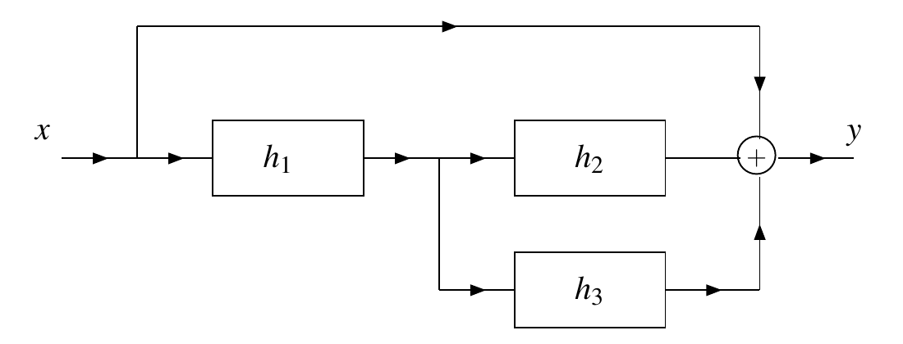
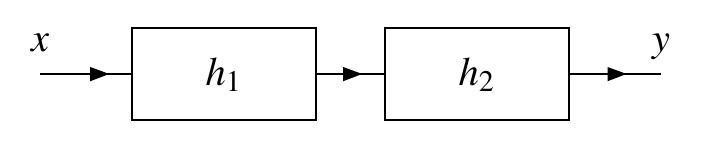
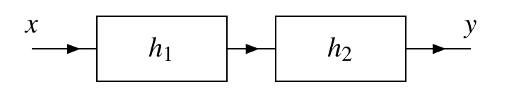

# ECE265 Tutorial 5

## Assignment 3B: LTI Systems

T02 · Ruilin Wang

This file contains a recap, complete worked regular examples, and the MATLAB task statements with ideas and pseudocode for Assignment 3B. References use **printed** pages from the slides and textbook, Edition **7.0.0-beta.3**.

For the lecture overview, use Lecture Summary 4, §§3-8 (impulses, responses and interconnections), and Lecture Summary 5, §§1-3 (inverse systems, stability and exponential inputs). The Fourier-series and DFT topics in Summary 5 are not needed for these examples.

### Selected practice examples

| Assigned question | Selected example | Main method |
| --- | --- | --- |
| 4.11(a), (b) | 4.11(c) | Apply the system to an impulse; retain the integration restriction |
| 9.12(c) | 9.12(b) | Locate a shifted impulse inside a sum |
| 4.12(a), (b) | Original 4.12(a), (b), treated as one block-diagram example | Combine series, parallel and direct paths; then substitute the given responses |
| 4.13(b) | 4.13(a) | Cascade two CT systems, then apply the step input |
| 9.14(c) | 9.14(a) | The corresponding DT cascade procedure |
| 4.14(a), (g) | 4.14(d) | Test causality and memory from the impulse response |
| 9.15(f) | 9.104(b) | Simplify the DT step factors before testing properties |
| 4.15(g) | 4.15(a) | Test absolute integrability on the correct half-line |
| 9.17(f) | 9.106(b) | Test a two-sided geometric absolute sum |
| 4.16(a) | Adapted 4.16(a) | Check whether convolution gives the identity impulse |
| 9.16(b) | 9.105(a) | Expand a convolution with a difference of impulses |
| 4.17(a) | 4.109(d) | Convert sine/cosine to exponentials and evaluate the system function |
| 9.20(a) | 9.20(b) | Identify exponential bases and evaluate the DT system function |

The examples are unassigned textbook parts except the original 4.12 and the explicitly adapted 4.16(a). In the adaptation, use $h_1(t)=\frac{1}{3}\delta(t-2)$ and $h_2(t)=3\delta(t+2)$ instead of the original gains and shifts.

**In class:** original 4.12, 9.12(b), 9.106(b), and 4.109(d), followed by MATLAB 9.201 and the essential steps of 9.202. The remaining regular examples are for self-study or backup. Use the recap below for preparation and reference; the tutorial starts directly with examples.

## 1. Finding an impulse response: replace the input, not every variable

For a system operator $\mathcal{H}$, its impulse response is

$$
h=\mathcal{H}\delta.
$$

For an **LTI** system, the input-output rule is $y=x\ast h$. To find $h$ from a given input-output equation, replace the input signal $x$ by $\delta$, then simplify the resulting integral or sum. Do not replace the output variable $t$ or $n$ by zero.

For CT, the sifting rule is

$$
\int_{-\infty}^{\infty}\delta(\tau-\tau_0)F(\tau)\thinspace d\tau=F(\tau_0),
$$

when $F$ is well behaved at the impulse location. If the integration range is restricted, first check whether it contains $\tau_0$. At a moving boundary, use the step convention $u(0)=1$, as in the textbook's ideal-integrator Example 4.16, p. 109; do not treat the Dirac impulse as an ordinary finite-height sample.

For DT, with integer $k_0$,

$$
\sum_{k=L}^{U}\delta(k-k_0)F(k)=
\begin{cases}
F(k_0),&L\le k_0\le U\cr
0,&\text{otherwise}.
\end{cases}
$$

DT endpoints are included. In particular, $u(0)=1$.

**Method:** solve the impulse argument equal to zero, evaluate **every remaining factor** at that location, and retain any restriction on the output variable. For an input written $x(k+q)$, the impulse input becomes $\delta(k+q)$, whose location is $k=-q$, not $k=q$. If changing variables instead, set $\ell=k+q$, substitute $k=\ell-q$ throughout, and update both limits. The CT change of variable follows the same bookkeeping, but uses an integral and differential.

**Trap:** a summation/integration variable disappears after sifting; the output variable remains. An arbitrary function named $v$ in a question is not automatically the unit ramp.

**References:** slide p. 132; textbook §4.5, pp. 95-97, and §9.5, pp. 414-416. Practice: 4.11(c), 9.12(b).

## 2. Interconnections: find the overall response before applying the input

For compatible LTI systems, identify the connection type first:

| Connection | Overall impulse response |
| --- | --- |
| Series/cascade | $h=h_1\ast h_2$ |
| Parallel, with outputs added | $h=h_1+h_2$ |
| Unchanged direct path | $h=\delta$ |

**Method:** trace each path from input to output. Convolve the responses along a series path; add the responses of parallel paths at an adder. After obtaining the overall $h$, calculate the requested output using $y=x\ast h$. A request for $h$ and a request for $y$ are different tasks.

Useful identities are

$$
x\ast\delta=x,
\qquad
\bigl\lbrack x\ast\delta(\mathord{\cdot}-a)\bigr\rbrack(\xi)=x(\xi-a),
$$

and

$$
\bigl\lbrack A\delta(\mathord{\cdot}-a)\bigr\rbrack\ast
\bigl\lbrack B\delta(\mathord{\cdot}-b)\bigr\rbrack
=AB\delta(\mathord{\cdot}-(a+b)).
$$

Here $\xi=t$ in CT and $\xi=n$ in DT; $a,b$ must be integers in DT. The dot denotes the signal's argument. Gains multiply and shifts add, with their signs retained.

For a step input, the output is the step response:

$$
y(t)=\int_{-\infty}^{t}h(\tau)\thinspace d\tau
\quad\text{(CT)},
\qquad
y(n)=\sum_{k=-\infty}^{n}h(k)
\quad\text{(DT)}.
$$

In DT, step factors become inequalities that determine the integer sum limits. For a finite geometric sum with integer $M\ge0$,

$$
\sum_{k=0}^{M}r^k=\frac{1-r^{M+1}}{1-r}\quad(r\ne1).
$$

There are $M+1$ terms; when $r=1$, the sum is $M+1$. A finite sum does not require $|r|\lt1$.

**Trap:** a direct path has impulse response $\delta$, not the constant signal $1$. An unshifted-impulse cascade is a useful first example, but does not demonstrate all shifted-input or geometric-sum cases.

**References:** slides pp. 130, 132-135; textbook §§4.7-4.8, pp. 99-101, and §§9.7-9.8, pp. 417-419; step response in §4.6, pp. 97-99, and §9.6, pp. 416-417; finite sum in Appendix E.5, pp. 734-735. Practice: original 4.12, 4.13(a), 9.14(a).

## 3. Causality and memory: two separate tests

For an LTI system:

| Property | Impulse-response test | Meaning |
| --- | --- | --- |
| Causal | $h(\xi)=0$ for every $\xi\lt0$ | No dependence on future input |
| Memoryless | $h=K\delta$ for a constant $K$ | $y(\xi)=Kx(\xi)$ uses only the present input |

Here $\xi=t$ in CT and $\xi=n$ in DT. A nonzero impulse at the origin is allowed by both tests. A nonzero pure delay can be causal but still has memory.

**Method:** simplify the given $h$ first, find where it can be nonzero, then apply each test independently. For DT step products, translate **each** factor into an inequality and intersect the conditions; inspect the boundary samples explicitly.

**Trap:** a causal input does not establish that a system is causal. These impulse-response tests assume the system is LTI. In CT, $K\delta(t)$ is an impulse, not an ordinary function with a finite nonzero value only at $t=0$.

**References:** slides pp. 137-138; textbook §§4.9.1-4.9.2, pp. 102-103, and §§9.9.1-9.9.2, pp. 420-421. Practice: 4.14(d), 9.104(b).

## 4. BIBO stability: absolute area or absolute sum

Bounded-input bounded-output (**BIBO**) stability means every bounded input produces a bounded output. For an ordinary CT impulse-response function, test

$$
\int_{-\infty}^{\infty}|h(t)|\thinspace dt\lt\infty.
$$

For a DT impulse response, test

$$
\sum_{n=-\infty}^{\infty}|h(n)|\lt\infty.
$$

**CT method:** use step factors to find the integration interval, simplify the absolute value, and evaluate the improper integral using a limit. For example, a left-infinite interval means

$$
\int_{-\infty}^{b}|h(t)|\thinspace dt
=\lim_{R\to\infty}\int_{-R}^{b}|h(t)|\thinspace dt.
$$

Decide whether the exponential decays at the **infinite end of that interval**. For a real nonzero constant $c$, $\int e^{ct}\thinspace dt=e^{ct}/c+C$. A restriction on a parameter is part of the question; retain it throughout.

**DT method:** split a two-sided sum into negative indices, the origin, and positive indices. If the absolute-value sequence is even, write

$$
\sum_{n=-\infty}^{\infty}|h(n)|
=|h(0)|+2\sum_{n=1}^{\infty}|h(n)|.
$$

For an infinite geometric tail,

$$
\sum_{n=1}^{\infty}r^n=\frac{r}{1-r},\qquad |r|\lt1.
$$

**Trap:** being bounded is not enough for $h$ to be absolutely integrable/summable. Do not use cancellation in a signed integral/sum, or count $n=0$ twice. Stability and causality are separate properties. The ordinary CT integral test above must not be applied to a Dirac impulse as if it were an ordinary function.

**References:** slide p. 140; textbook §4.9.4, pp. 106-109, and §9.9.4, pp. 425-427; integration and geometric-series tools in Appendix E.4-E.5, pp. 734-735. Practice: 4.15(a), 9.106(b).

## 5. Inverse systems: the convolution must equal the identity

Two compatible LTI systems are inverses of one another when

$$
h_1\ast h_2=\delta.
$$

Then cascading them returns the input: $x\ast(h_1\ast h_2)=x$. Use the same convolution identities as for interconnections.

**Method:** for scaled, shifted impulses, track both the gain and the total shift. For a response containing several impulses, distribute convolution first. In DT, for integer $m$,

$$
\bigl\lbrack g\ast(A\delta+B\delta(\mathord{\cdot}-m))\bigr\rbrack(n)
=Ag(n)+Bg(n-m).
$$

Substitute the given $g$ and check the resulting sequence at its boundary indices as well as on either side. Compare the **complete** result with $\delta(n)$, not only a few convenient samples.

**Trap:** an inverse impulse response is not the pointwise reciprocal $1/h$. A remaining gain or delay is not the identity. An inverse need not share the original system's causality or stability.

**References:** slide p. 139; textbook §4.9.3, pp. 104-106, and §9.9.3, pp. 422-425. Practice: adapted 4.16(a), 9.105(a).

## 6. Exponential inputs: evaluate the system function at the right argument

An exponential keeps its shape through an LTI system, receiving a constant multiplier:

$$
\mathcal{H}\lbrace e^{st}\rbrace=H(s)e^{st}
\quad\text{(CT)},
\qquad
\mathcal{H}\lbrace z^n\rbrace=H(z)z^n
\quad\text{(DT, }z\ne0\text{)}.
$$

The system functions are

$$
H(s)=\int_{-\infty}^{\infty}h(\tau)e^{-s\tau}\thinspace d\tau,
\qquad
H(z)=\sum_{k=-\infty}^{\infty}h(k)z^{-k}.
$$

Use an evaluation only where the defining integral/sum converges. If the question supplies a domain, check every required argument against it.

**Method:** rewrite the input as a finite sum of exponentials. For each term, identify its coefficient and exponent/base, evaluate $H$ there, multiply that term by the result, and add the outputs. A negative input coefficient stays negative.

For sine and cosine, use

$$
\cos(\omega\xi)=\frac{e^{j\omega\xi}+e^{-j\omega\xi}}{2},
\qquad
\sin(\omega\xi)=\frac{e^{j\omega\xi}-e^{-j\omega\xi}}{2j}.
$$

| Input component | CT evaluation | DT evaluation |
| --- | --- | --- |
| Constant $C$ | $CH(0)$ | $CH(1)$ |
| Positive-frequency exponential | $H(j\omega)$ | $H(e^{j\omega})$ |
| Negative-frequency exponential | $H(-j\omega)$ | $H(e^{-j\omega})$ |

In DT, $r^n$ uses $H(r)$ directly. For a real impulse response, the two sinusoidal evaluations are conjugate pairs; combine the paired exponential terms back into a real sine/cosine expression.

**Trap:** CT uses the exponential **rate** $s$; DT uses its **base** $z$. Do not substitute the DT angular frequency itself into $H(z)$, or treat a constant DT sequence as an evaluation at zero.

**References:** slides pp. 141-142; textbook §4.10, pp. 109-113, and §9.10, pp. 428-431. Practice: 4.109(d), 9.20(b).

## 7. Audio bridge: impulse locations become array positions

A generic finite weighted-delay impulse response has the form

$$
h(n)=\sum_{r=0}^{R}c_r\delta(n-m_r),
\qquad
y(n)=\sum_{r=0}^{R}c_rx(n-m_r),
$$

where $R$ is a nonnegative integer and the $m_r$ are integer delays. For the causal audio responses used here, $m_r\ge0$. Each impulse produces a scaled, shifted copy of the input. Add those contributions; if several delays coincide, their weights add at the same location.

For a sample rate $f_s$ in samples per second, a delay of $d$ seconds corresponds to $f_sd$ samples before integer rounding. Follow the question's rounding rule. If a MATLAB array stores a causal response beginning at $n=0$, sequence index $m$ corresponds to array position $m+1$. The positions between impulses still contain zeros.

For input and impulse-response arrays with stored lengths $L_x$ and $L_h$, full convolution has length $L_x+L_h-1$. Keep the complete tail. Audio input and impulse response must use the same sample rate **before** convolution; relabelling a sample rate is not resampling.

**Trap:** an impulse's delay is not its array position. For a sum, update the response by **adding** each contribution rather than overwriting an earlier contribution at the same position. Changing one experiment parameter at a time makes its effect easier to identify.

**References:** slides pp. 130, 132; textbook §9.2, pp. 399-410, and §9.5, pp. 414-416; MATLAB exercise statements 9.201-9.202, pp. 437-438.

## Coverage notes

- 4.11(a), (b): §1 supplies the general impulse/range method; selected 4.11(c) does not demonstrate an advanced upper limit or shifted input.
- 4.13(b): §2 supplies the shifted-impulse identity; selected 4.13(a) has no shift.
- 9.14(c): §2 supplies step-response limits and the finite geometric sum; selected 9.14(a) does not work through that sum.
- 4.14(g): §3 includes the origin-only impulse criterion; selected 4.14(d) instead demonstrates a delayed ordinary response.
- 4.15(g): §4 supplies the stability test; selected 4.15(a) does not teach Gaussian integration or classify an arbitrary real parameter. For the Gaussian integral, consult textbook Appendix E.4, formula (E.7), p. 734.
- 9.16(b): §5 supplies shifted-sequence cancellation; selected 9.105(a) omits geometric weighting.
- 4.17(a): §6 includes the constant-input rule; selected 4.109(d) has no constant term.
- 9.20(a): §6 supplies the DT Euler/evaluation bridge; selected 9.20(b) uses real exponential bases, not sine/cosine.

## 4.11(c): Problem

**Self-study example.** Textbook §4.11.1, p. 117. Selected subpart reproduced below.

Find the impulse response of the LTI system $\mathcal{H}$ characterized by each of the equations below.

(c)

$$
\mathcal{H}x(t)=\int_{-\infty}^{t}x(\tau)v(t-\tau)\thinspace d\tau;\quad\text{and}
$$

### Knowledge points

- Impulse response and the LTI input-output relation: slide p. 132; textbook §4.5, pp. 95-97.
- CT unit-step convention: textbook §3.5.4, pp. 40-41. This book uses $u(0)=1$.
- The function $v$ is left unspecified in this question. Do not assume that it is a unit ramp.

### Core bridge formula

The impulse response is the output for an impulse input:

$$
h=\mathcal{H}\delta.
$$

The equivalent convolution form is

$$
\mathcal{H}x(t)=\int_{-\infty}^{\infty}x(\tau)h(t-\tau)\thinspace d\tau.
$$

An upper limit of $t$ can be represented by a factor $u(t-\tau)$ inside an integral over the entire real line. This retains the restriction $\tau\le t$.

### Answer

**1. Replace the input $x$ by $\delta$.** The output variable $t$ remains unchanged:

$$
h(t)=\int_{-\infty}^{t}\delta(\tau)v(t-\tau)\thinspace d\tau.
$$

The impulse is located at $\tau=0$.

**2. Check whether the integration interval reaches the impulse.**

- If $t\lt0$, the interval ends before $\tau=0$, so $h(t)=0$.
- If $t\gt0$, the impulse lies inside the interval. Sifting replaces $\tau$ by zero in the remaining factor:

$$
h(t)=v(t-0)=v(t).
$$

**3. Retain the integration restriction in the result.** Equivalently, rewrite the original rule as

$$
\mathcal{H}x(t)=\int_{-\infty}^{\infty}
x(\tau)v(t-\tau)u(t-\tau)\thinspace d\tau.
$$

Comparing this expression with the convolution formula identifies the complete impulse response:

$$
\boxed{h(t)=v(t)u(t).}
$$

With the textbook's unit-step convention, the representative at the boundary is $h(0)=v(0)$, when $v(0)$ is defined. Thus it can be written

$$
h(t)=\begin{cases}
0,&t\lt0\cr
v(t),&t\ge0.
\end{cases}
$$

As with the textbook's ideal-integrator example, the CT boundary is represented using the chosen step convention; changing one finite point does not change the convolution integral for ordinary inputs.

## 9.12(b): Problem

**In-class example.** Textbook §9.11.1, p. 434.

Find the impulse response of the LTI system $\mathcal{H}$ characterized by each of the equations below.

(b)

$$
\mathcal{H}x(n)=\sum_{k=-\infty}^{\infty}x(k+5)e^{k-n+1}u(n-k-2);
$$

### Knowledge points

- Slides p. 132: the impulse response is the response to the input $\delta$.
- Textbook §9.5, pp. 414-416: $h=\mathcal{H}\delta$ and $y=x\ast h$ for an LTI system; Example 9.8, pp. 414-415, applies impulse sifting to a summation.
- Recap §1: locate the impulse first, substitute that index into every remaining factor, and retain the step restriction.

### Core bridge formula

The definition is

$$
h(n)=\mathcal{H}\delta(n).
$$

For an integer $k_0$, the DT sifting identity is

$$
\sum_{k=-\infty}^{\infty}\delta(k-k_0)F(k)=F(k_0).
$$

If the input in the system rule is $x(k+q)$, replacing the input by $\delta$ gives $\delta(k+q)$. Its nonzero location satisfies $k+q=0$, so it is $k=-q$.

### Answer

**1. Replace only the input signal by the unit impulse.**

In the given rule, $x(k+5)$ becomes $\delta(k+5)$. The output index $n$ does not change:

$$
h(n)=\sum_{k=-\infty}^{\infty}\delta(k+5)e^{k-n+1}u(n-k-2).
$$

**2. Find the one summation index that survives.**

The impulse is nonzero only when

$$
k+5=0\quad\Longrightarrow\quad k=-5.
$$

Because the sum covers all integer $k$, it includes $k=-5$. Every other term is zero.

**3. Substitute $k=-5$ into both remaining factors.**

The exponential becomes

$$
e^{k-n+1}\big|_{k=-5}=e^{-5-n+1}=e^{-n-4}.
$$

The step becomes

$$
u(n-k-2)\big|_{k=-5}=u(n-(-5)-2)=u(n+3).
$$

Therefore,

$$
\boxed{h(n)=e^{-n-4}u(n+3).}
$$

**4. State the result for all integer $n$, including the boundary.**

The step is one when $n+3\ge0$, or $n\ge-3$. Since the DT convention is $u(0)=1$,

$$
\boxed{
h(n)=\begin{cases}
0,&n\le-4\cr
e^{-n-4},&n\ge-3.
\end{cases}}
$$

For example, $h(-4)=0$, whereas $h(-3)=e^{3-4}=e^{-1}$. The first nonzero sample is at $n=-3$, not at $n=3$.

## 4.12: Problem

**In-class example.** Textbook §4.11.1, p. 117. Parts (a) and (b) form one block-diagram example. This is the original assigned question, not an unassigned substitute.

Consider the system with input $x$ and output $y$ as shown in the figure below. Each system in the block diagram is LTI and labelled with its impulse response.



(a) Find the impulse response $h$ of the overall system in terms of $h_1$, $h_2$, and $h_3$.

(b) Determine the impulse response $h$ in the specific case that

$$
h_1(t)=\delta(t+1),\qquad h_2(t)=\delta(t),\qquad\text{and}\qquad h_3(t)=\delta(t).
$$

### Knowledge points

- Convolutional identity: slide p. 130; textbook §4.3, pp. 91-94.
- LTI block diagrams and series/parallel connections: slides pp. 134-135; textbook §§4.7-4.8, pp. 99-101.
- Shifted impulses and sifting: textbook §3.5.12, pp. 45-50.

### Core bridge formula

For LTI systems,

$$
h_{\mathrm{series}}=h_1\ast h_2,
\qquad
h_{\mathrm{parallel}}=h_1+h_2,
\qquad
h_{\mathrm{direct}}=\delta.
$$

The direct path uses the identity $x\ast\delta=x$. For shifted impulses, gains multiply and signed shifts add:

$$
\bigl\lbrack A\delta(\mathord{\cdot}-a)\bigr\rbrack\ast
\bigl\lbrack B\delta(\mathord{\cdot}-b)\bigr\rbrack
=AB\delta(\mathord{\cdot}-(a+b)).
$$

Trace every complete path from the input to the output: convolve along each path, then add the path responses at the adder.

### Answer

**Part (a): identify the three paths.**

| Path from input to output | Its contribution to the output | Its impulse response |
| --- | --- | --- |
| Direct wire | $x$ | $\delta$ |
| Through $h_1$, then $h_2$ | $(x\ast h_1)\ast h_2$ | $h_1\ast h_2$ |
| Through $h_1$, then $h_3$ | $(x\ast h_1)\ast h_3$ | $h_1\ast h_3$ |

All three outputs are added with positive signs. Therefore,

$$
y=x+(x\ast h_1)\ast h_2+(x\ast h_1)\ast h_3.
$$

Replace $x$ in the direct path by $x\ast\delta$, and use associativity:

$$
y=x\ast\delta+x\ast(h_1\ast h_2)+x\ast(h_1\ast h_3).
$$

Distributivity gives

$$
y=x\ast\bigl(\delta+h_1\ast h_2+h_1\ast h_3\bigr).
$$

Comparing with $y=x\ast h$, the answer to part (a) is

$$
\boxed{h=\delta+h_1\ast h_2+h_1\ast h_3
=\delta+h_1\ast(h_2+h_3).}
$$

**Part (b): substitute the given impulse responses.** First calculate the path through $h_1$ and $h_2$:

Use the shifted-impulse convolution identity above, with gains $A=B=1$ and shifts $a=-1$, $b=0$. The following integral is its convolution form:

$$
(h_1\ast h_2)(t)
=\int_{-\infty}^{\infty}\delta(\tau+1)\delta(t-\tau)\thinspace d\tau.
$$

The first impulse has argument zero when $\tau+1=0$, so $\tau=-1$. Substitute this location into the other factor:

$$
(h_1\ast h_2)(t)=\delta\bigl(t-(-1)\bigr)=\delta(t+1).
$$

The second branch has exactly the same given response, $h_3(t)=h_2(t)=\delta(t)$. Hence its path response is also

$$
(h_1\ast h_3)(t)=\delta(t+1).
$$

Finally add the direct path and both branch responses:

$$
h(t)=\delta(t)+\delta(t+1)+\delta(t+1).
$$

$$
\boxed{h(t)=\delta(t)+2\delta(t+1).}
$$

The direct path contributes the impulse at zero. The two other paths contribute identical impulses at $t=-1$, so their coefficients add to $2$.

## 4.13(a): Problem

**Self-study example.** Textbook §4.11.1, p. 117. Selected subpart reproduced below.

Consider the system shown in the figure below with input $x$ and output $y$. This system is formed by the series interconnection of two LTI systems with the impulse responses $h_1$ and $h_2$.



For each pair of $h_1$ and $h_2$ given below, find the output $y$ if the input $x(t)=u(t)$.

(a) $h_1(t)=\delta(t)$ and $h_2(t)=\delta(t)$;

### Knowledge points

- Convolutional identity: slide p. 130; textbook §4.3, pp. 91-94.
- Impulse and step responses: slides pp. 132-133; textbook §§4.5-4.6, pp. 95-99.
- Series interconnection: slide p. 135; textbook §4.8, pp. 99-101.

### Core bridge formula

For a cascade of two LTI systems, first find its overall impulse response, then apply the input:

$$
h=h_1\ast h_2,
\qquad
y=x\ast h.
$$

The identity $f\ast\delta=f$ applies to both stages.

### Answer

**1. Find the overall impulse response.** Substitute the two given responses:

$$
h(t)=(\delta\ast\delta)(t).
$$

Convolving a signal with $\delta$ leaves that signal unchanged. Here that signal is itself $\delta$, so

$$
h(t)=\delta(t).
$$

**2. Apply the specified step input.** Substitute $x(t)=u(t)$ and the overall response into $y=x\ast h$:

$$
y(t)=(u\ast\delta)(t)=u(t).
$$

The question asks for the output, not just the overall impulse response. Therefore,

$$
\boxed{y(t)=u(t)=\begin{cases}
0,&t\lt0\cr
1,&t\ge0.
\end{cases}}
$$

There is no shift or gain in either stage, so the cascade leaves the input unchanged.

## 9.14(a): Problem

**Self-study example.** Textbook §9.11.1, p. 434.

Consider the system shown in the figure below with input $x$ and output $y$. This system is formed by the series interconnection of two LTI systems with the impulse responses $h_1$ and $h_2$.



For each pair of $h_1$ and $h_2$ given below, find the output $y$ if the input $x(n)=u(n)$.

(a) $h_1(n)=\delta(n)$ and $h_2(n)=\delta(n)$;

### Knowledge points

- Slides pp. 130, 132, and 135: the convolutional identity, LTI input-output relation, and series interconnection.
- Textbook §9.5, pp. 414-416, and §9.8, pp. 418-419: $y=x\ast h$ and the overall response of a cascade.
- Recap §2: find the overall impulse response first, then apply the specified input.

### Core bridge formula

For a cascade of two LTI systems,

$$
h=h_1\ast h_2,\qquad y=x\ast h.
$$

The unit impulse is the convolutional identity:

$$
f\ast\delta=f.
$$

### Answer

**1. Find the impulse response of the whole cascade.**

Substitute the two given impulse responses:

$$
h=h_1\ast h_2=\delta\ast\delta=\delta.
$$

Thus the cascade itself is an identity system.

**2. Apply the actual input, which is the unit step, not the unit impulse.**

$$
y=x\ast h=u\ast\delta=u.
$$

Written out as a sum, this calculation is

$$
y(n)=\sum_{k=-\infty}^{\infty}u(k)\delta(n-k)=u(n),
$$

because the impulse selects $k=n$.

The complete answer is

$$
\boxed{
y(n)=u(n)=\begin{cases}
0,&n\lt0\cr
1,&n\ge0.
\end{cases}}
$$

In particular, $y(0)=1$. The overall impulse response is $h=\delta$, but the requested output is $y=u$.

## 4.14(d): Problem

**Self-study example.** Textbook §4.11.1, p. 117. Selected subpart reproduced below.

Determine whether the LTI system with each impulse response $h$ given below is causal and/or memoryless.

(d)

$$
h(t)=e^{-4t}u(t-1);
$$

### Knowledge points

- Memory of an LTI system: slide p. 137; textbook §4.9.1, pp. 102-103.
- Causality of an LTI system: slide p. 138; textbook §4.9.2, p. 103.
- Unit-step support and boundary value: textbook §3.5.4, pp. 40-41.

### Core bridge formula

For an LTI system,

$$
\text{causal}\quad\Longleftrightarrow\quad h(t)=0\text{ for every }t\lt0,
$$

and

$$
\text{memoryless}\quad\Longleftrightarrow\quad h(t)=K\delta(t)
$$

for a constant $K$. In particular, any nonzero ordinary response away from the origin rules out memorylessness.

### Answer

**1. Find where $h$ can be nonzero.** The step factor is one when

$$
t-1\ge0\quad\Longleftrightarrow\quad t\ge1.
$$

Thus

$$
h(t)=\begin{cases}
0,&t\lt1\cr
e^{-4t},&t\ge1.
\end{cases}
$$

**2. Test causality.** Every negative time satisfies $t\lt1$, so $h(t)=0$ for every $t\lt0$. Therefore, the system is **causal**.

**3. Test memorylessness separately.** For example, at the nonzero time $t=2$,

$$
h(2)=e^{-4(2)}u(2-1)=e^{-8}u(1)=e^{-8}\ne0.
$$

The response is not confined to the origin and is not of the form $K\delta(t)$. Therefore, the system **has memory**.

$$
\boxed{\text{Causal, but not memoryless.}}
$$

## 9.104(b): Problem

**Self-study example.** Textbook §9.11.2, p. 436.

Determine whether the LTI system with each impulse response $h$ given below is causal and/or memoryless.

(b) $h(n)=u(n)u(-n)$;

### Knowledge points

- Slides pp. 137-138: separate impulse-response tests for memorylessness and causality.
- Textbook §9.9.1, p. 420, and §9.9.2, p. 421: a memoryless LTI response has the form $K\delta$; a causal LTI response is zero at all negative indices.
- Recap §3: simplify a product of steps by intersecting their nonzero-index conditions.

### Core bridge formula

For DT, $u(n)=1$ when $n\ge0$ and $u(n)=0$ when $n\lt0$, including $u(0)=1$.

For an LTI system,

$$
\text{causal}\quad\Longleftrightarrow\quad h(n)=0\text{ for every }n\lt0,
$$

and

$$
\text{memoryless}\quad\Longleftrightarrow\quad h(n)=K\delta(n)
$$

for a constant $K$.

### Answer

**1. Determine where the product is nonzero.**

The first factor requires $n\ge0$. The second requires $-n\ge0$, or $n\le0$. Both requirements hold only at $n=0$.

Check all three cases explicitly:

$$
h(n)=u(n)u(-n)=\begin{cases}
0\cdot1=0,&n\lt0\cr
1\cdot1=1,&n=0\cr
1\cdot0=0,&n\gt0.
\end{cases}
$$

This is exactly the unit-impulse sequence:

$$
h(n)=\delta(n).
$$

**2. Test causality.**

There are no nonzero samples for $n\lt0$, so the system is **causal**.

**3. Test memorylessness.**

The response is $K\delta(n)$ with $K=1$, so the system is **memoryless**. Indeed, its input-output rule is

$$
y(n)=(x\ast\delta)(n)=x(n).
$$

The output at $n$ uses only the input at that same index.

**Final result: the system is both causal and memoryless.**

## 4.15(a): Problem

**Self-study example.** Textbook §4.11.1, p. 118. Selected subpart reproduced below.

Determine whether the LTI system with each impulse response $h$ given below is BIBO stable.

(a)

$$
h(t)=e^{at}u(-t)
$$

where $a$ is a strictly positive real constant;

### Knowledge points

- Bounded-input bounded-output (BIBO) stability: slide p. 140; textbook §4.9.4, pp. 106-109.
- The step factor determines the integration interval: textbook §3.5.4, pp. 40-41.
- Exponential integration: textbook Appendix E.4, p. 734.

### Core bridge formula

For an ordinary CT impulse-response function, an LTI system is BIBO stable if and only if

$$
\int_{-\infty}^{\infty}|h(t)|\thinspace dt\lt\infty.
$$

An integral extending to negative infinity is evaluated with a limit. For a nonzero real constant $a$,

$$
\int e^{at}\thinspace dt=\frac{e^{at}}{a}+C.
$$

The sign of the exponent must be interpreted together with the direction in which time approaches infinity.

### Answer

**1. Use the step factor to find the interval.** The factor $u(-t)$ is one when

$$
-t\ge0\quad\Longleftrightarrow\quad t\le0.
$$

Therefore, only the left half-line contributes to the integral. Since $a$ and $t$ are real, $e^{at}>0$, so its absolute value is itself:

$$
\int_{-\infty}^{\infty}|h(t)|\thinspace dt
=\int_{-\infty}^{0}e^{at}\thinspace dt.
$$

**2. Evaluate the improper integral.** Introduce a positive number $R$ and then take $R\to\infty$:

$$
\int_{-\infty}^{0}e^{at}\thinspace dt
=\lim_{R\to\infty}\int_{-R}^{0}e^{at}\thinspace dt.
$$

Using the antiderivative and substituting both endpoints gives

$$
\int_{-R}^{0}e^{at}\thinspace dt
=\frac{e^{a(0)}}{a}-\frac{e^{a(-R)}}{a}
=\frac{1-e^{-aR}}{a}.
$$

**3. Apply the given condition $a>0$.** Then $-aR\to-\infty$ as $R\to\infty$, and consequently $e^{-aR}\to0$. Hence

$$
\int_{-\infty}^{\infty}|h(t)|\thinspace dt
=\frac{1-0}{a}=\frac{1}{a}\lt\infty.
$$

$$
\boxed{\text{The system is BIBO stable for every given }a>0.}
$$

Although the exponent is $at$ with positive $a$, the response is supported on $t\le0$; it decays as $t\to-\infty$.

## 9.106(b): Problem

**In-class example.** Textbook §9.11.2, p. 437.

Determine whether the LTI system with each impulse response $h$ given below is BIBO stable.

(b)

$$
h(n)=\left(\frac{2}{3}\right)^{|n|};
$$

### Knowledge points

- Slide p. 140: a DT LTI system is BIBO stable if and only if its impulse response is absolutely summable.
- Textbook §9.9.4, pp. 425-427: the absolute-sum criterion and its output bound.
- Textbook Appendix E.5, p. 735, equation (E.11): an infinite geometric series converges for $|r|\lt1$.
- Recap §4: split the negative tail, the origin, and the positive tail; count the origin only once.

### Core bridge formula

The DT LTI stability test is

$$
\sum_{n=-\infty}^{\infty}|h(n)|\lt\infty.
$$

For an even absolute-value sequence, it becomes

$$
\sum_{n=-\infty}^{\infty}|h(n)|=|h(0)|+2\sum_{n=1}^{\infty}|h(n)|.
$$

The required geometric-series formula is

$$
\sum_{n=1}^{\infty}r^n=\frac{r}{1-r},\qquad |r|\lt1.
$$

### Answer

**1. Simplify the absolute value.**

The base $2/3$ is positive, so every value of $h(n)$ is positive. Therefore,

$$
|h(n)|=\left(\frac{2}{3}\right)^{|n|}.
$$

**2. Split the sum without counting $n=0$ twice.**

At the origin,

$$
h(0)=\left(\frac{2}{3}\right)^0=1.
$$

For $n\ge1$, $|n|=n$. For $n\le-1$, set $m=-n$, so $m=1,2,3,\ldots$ and $|n|=m$. Hence,

$$
\sum_{n=-\infty}^{-1}\left(\frac{2}{3}\right)^{|n|}
=\sum_{m=1}^{\infty}\left(\frac{2}{3}\right)^m.
$$

The two tails are equal, giving

$$
\sum_{n=-\infty}^{\infty}|h(n)|
=1+2\sum_{n=1}^{\infty}\left(\frac{2}{3}\right)^n.
$$

**3. Evaluate the geometric tail.**

Here $r=2/3$, so $|r|=2/3\lt1$ and the series converges. Substitute into the formula:

$$
\sum_{n=1}^{\infty}\left(\frac{2}{3}\right)^n
=\frac{2/3}{1-2/3}
=\frac{2/3}{1/3}
=2.
$$

Therefore,

$$
\sum_{n=-\infty}^{\infty}|h(n)|=1+2(2)=5\lt\infty.
$$

**Final result: the system is BIBO stable.**

#### Output-bound check (Optional)

If $|x(n)|\le A$ for every $n$, convolution gives

$$
|y(n)|\le A\sum_{k=-\infty}^{\infty}|h(k)|=5A.
$$

This is one finite bound for the entire output.

## 4.16(a): Problem

**Self-study example.** Textbook §4.11.1, p. 118. **Tutorial adaptation:** the common stem is unchanged, but the gains and shifts in part (a) are changed as specified below.

For each pair of LTI systems with impulse responses $h_1$ and $h_2$ given below, determine whether these systems are inverses of one another.

Original part (a):

$$
h_1(t)=\frac{1}{2}\delta(t-1)\quad\text{and}\quad h_2(t)=2\delta(t+1).
$$

**Use these adapted expressions for this tutorial:**

$$
h_1(t)=\frac{1}{3}\delta(t-2)\quad\text{and}\quad h_2(t)=3\delta(t+2).
$$

The first gain changes from $1/2$ to $1/3$, the second gain from $2$ to $3$, the first delay from $1$ to $2$, and the second shift from an advance of $1$ to an advance of $2$. The task itself is unchanged.

### Knowledge points

- LTI inverse criterion: slide p. 139; textbook §4.9.3, pp. 104-106, especially Example 4.12.
- Convolutional identity and shifted impulses: slide p. 130; textbook §4.3, pp. 91-94.
- Series interconnection: slide p. 135; textbook §4.8, pp. 99-101.

### Core bridge formula

Two compatible LTI systems are inverses when their cascade has the identity impulse response:

$$
h_1\ast h_2=\delta.
$$

For scaled, shifted impulses,

$$
\bigl\lbrack A\delta(\mathord{\cdot}-a)\bigr\rbrack\ast
\bigl\lbrack B\delta(\mathord{\cdot}-b)\bigr\rbrack
=AB\delta(\mathord{\cdot}-(a+b)).
$$

Both the product of the gains and the sum of the shifts must match the identity: gain $1$ and total shift $0$.

### Answer

**1. Form the cascade response using the adapted data.**

$$
(h_1\ast h_2)(t)
=\int_{-\infty}^{\infty}
\left(\frac{1}{3}\delta(\tau-2)\right)
\left(3\delta(t-\tau+2)\right)\thinspace d\tau.
$$

**2. Multiply the gains.** Since $(1/3)(3)=1$,

$$
(h_1\ast h_2)(t)
=\int_{-\infty}^{\infty}\delta(\tau-2)\delta(t-\tau+2)\thinspace d\tau.
$$

**3. Use the shifted-impulse convolution identity.** The first impulse has shift $2$ and the second has shift $-2$. Their gains already multiply to $1$, so the total shift is $2+(-2)=0$. In the integral representation above, this is the formal substitution $\tau=2$ into the second impulse:

$$
(h_1\ast h_2)(t)=\delta(t-2+2)=\delta(t).
$$

This also shows the cancellation of the shifts: $\delta(t-2)$ is a delay of $2$, while $\delta(t+2)=\delta(t-(-2))$ is a delay of $-2$. Their sum is $2+(-2)=0$.

**4. Compare with the inverse criterion.** The cascade response is exactly $\delta$, so its output for any compatible input is

$$
y=x\ast(h_1\ast h_2)=x\ast\delta=x.
$$

Convolution is commutative, so the reverse cascade also returns $x$.

$$
\boxed{\text{Yes, the two adapted systems are inverses of one another.}}
$$

## 9.105(a): Problem

**Self-study example.** Textbook §9.11.2, p. 436.

For each pair of LTI systems with impulse responses $g$ and $h$ given below, determine whether these systems are inverses of one another.

(a) $g(n)=u(n)$ and $h(n)=\delta(n)-\delta(n-1)$;

### Knowledge points

- Slide p. 139: inverse LTI systems have impulse responses whose convolution is $\delta$.
- Slides pp. 130 and 135: the convolutional identity and a series interconnection.
- Textbook §9.9.3, pp. 422-425: the inverse-system criterion; the worked differencing/accumulation example on pp. 424-425 uses the same identity.
- Recap §5: distribute convolution over a sum of impulses and check every boundary case.

### Core bridge formula

Two LTI systems are inverses when

$$
g\ast h=\delta.
$$

For an integer shift $m$,

$$
(g\ast\delta)(n)=g(n),
\qquad
\bigl\lbrack g\ast\delta(\mathord{\cdot}-m)\bigr\rbrack(n)=g(n-m).
$$

Distribute convolution over the separate terms before substituting the response $g$.

### Answer

**1. Compute the impulse response of the cascade.**

Substitute $h(n)=\delta(n)-\delta(n-1)$ and distribute:

$$
(g\ast h)(n)
=(g\ast\delta)(n)
-\bigl\lbrack g\ast\delta(\mathord{\cdot}-1)\bigr\rbrack(n)
=g(n)-g(n-1).
$$

Using $g(n)=u(n)$ gives

$$
(g\ast h)(n)=u(n)-u(n-1).
$$

**2. Evaluate the difference for all integer $n$.**

- If $n\lt0$, then $n\lt0$ and $n-1\lt0$. Both steps are zero, so the difference is $0-0=0$.
- If $n=0$, then $u(0)=1$ and $u(-1)=0$. The difference is $1-0=1$.
- If $n\ge1$, then $n\ge0$ and $n-1\ge0$. Both steps are one, so the difference is $1-1=0$.

Thus,

$$
(g\ast h)(n)=\begin{cases}
0,&n\lt0\cr
1,&n=0\cr
0,&n\gt0
\end{cases}
=\delta(n).
$$

**3. Compare with the identity response.**

The cascade response is exactly $\delta$, with no remaining gain or shift. Convolution is commutative, so $h\ast g=\delta$ as well.

**Final result: the two LTI systems are inverses of one another.**

## 4.109(d): Problem

**In-class example.** Textbook §4.11.2, p. 123. Selected subpart reproduced below.

For each case below, find the response $y$ of the LTI system with system function $H$ to the input $x$.

(d)

$$
H(s)=se^{-s}\quad\text{for all }s\in\mathbb{C};
\quad\text{and}\quad x(t)=4\cos(t)+2\sin(3t);
$$

### Knowledge points

- Complex exponentials are eigenfunctions of CT LTI systems: slide p. 141; textbook §4.10, pp. 109-110.
- Superposition of exponential inputs: slide p. 142; textbook §4.10, pp. 111-113.
- Euler's sine/cosine identities: textbook §3.5.3, p. 40.
- A system-function evaluation must lie in its stated domain. Here the domain is all of $\mathbb{C}$, so all four required evaluations are allowed.

### Core bridge formula

For a complex exponential input,

$$
\mathcal{H}\lbrace e^{st}\rbrace=H(s)e^{st}.
$$

For a finite sum, linearity gives

$$
x(t)=\sum_k a_ke^{s_kt}
\quad\Longrightarrow\quad
y(t)=\sum_k a_kH(s_k)e^{s_kt}.
$$

Use Euler's identities to put real sinusoids into this form:

$$
\cos\theta=\frac{e^{j\theta}+e^{-j\theta}}{2},
\qquad
\sin\theta=\frac{e^{j\theta}-e^{-j\theta}}{2j}.
$$

### Answer

**1. Rewrite the input as a sum of exponentials.** Substitute the identities into each input term:

$$
4\cos(t)=4\left(\frac{e^{jt}+e^{-jt}}{2}\right)
=2e^{jt}+2e^{-jt},
$$

$$
2\sin(3t)=2\left(\frac{e^{j3t}-e^{-j3t}}{2j}\right)
=\frac{1}{j}e^{j3t}-\frac{1}{j}e^{-j3t}.
$$

Since $j^2=-1$, we have $1/j=-j$. Therefore,

$$
x(t)=2e^{jt}+2e^{-jt}-je^{j3t}+je^{-j3t}.
$$

The four rates at which to evaluate $H$ are $j$, $-j$, $3j$, and $-3j$.

**2. Evaluate the given system function at every rate.** Substitute each rate into $H(s)=se^{-s}$:

$$
H(j)=je^{-j},\qquad H(-j)=(-j)e^{-(-j)}=-je^{j},
$$

$$
H(3j)=3je^{-3j},\qquad H(-3j)=(-3j)e^{-(-3j)}=-3je^{3j}.
$$

All four rates belong to the stated domain $s\in\mathbb{C}$.

**3. Multiply each exponential input by its corresponding eigenvalue.**

$$
y(t)=2H(j)e^{jt}+2H(-j)e^{-jt}
-jH(3j)e^{j3t}+jH(-3j)e^{-j3t}.
$$

Substitute all four values:

$$
y(t)=2(je^{-j})e^{jt}+2(-je^{j})e^{-jt}
-j(3je^{-3j})e^{j3t}+j(-3je^{3j})e^{-j3t}.
$$

For the last two coefficients, $(-j)(3j)=-3j^2=3$ and $j(-3j)=-3j^2=3$. Combine the exponential factors by adding their exponents:

$$
y(t)=2je^{j(t-1)}-2je^{-j(t-1)}
+3e^{j3(t-1)}+3e^{-j3(t-1)}.
$$

**4. Combine the conjugate-frequency pairs into real functions.** For the first pair, use $e^{j\theta}-e^{-j\theta}=2j\sin\theta$:

$$
2j\bigl(e^{j(t-1)}-e^{-j(t-1)}\bigr)
=2j\bigl(2j\sin(t-1)\bigr)
=4j^2\sin(t-1)
=-4\sin(t-1).
$$

For the second pair, use $e^{j\theta}+e^{-j\theta}=2\cos\theta$:

$$
3\bigl(e^{j3(t-1)}+e^{-j3(t-1)}\bigr)
=3\bigl(2\cos(3(t-1))\bigr)
=6\cos(3t-3).
$$

Adding the two real contributions gives the final output:

$$
\boxed{y(t)=-4\sin(t-1)+6\cos(3t-3).}
$$

## 9.20(b): Problem

**Self-study example.** Textbook §9.11.1, p. 435.

For each case below, find the response $y$ of the LTI system with system function $H$ to the input $x$.

(b)

$$
H(z)=\frac{1}{z-\frac{1}{2}}\text{ for }|z|>\frac{1}{2};
\text{ and }x(n)=10+5(3)^n-3\left(\frac{3}{4}\right)^n.
$$

### Knowledge points

- Slides pp. 141-142: complex exponentials are eigensequences of an LTI system; use linearity for a finite sum.
- Textbook §9.10, pp. 428-431, especially pp. 428-429: evaluate $H$ at each exponential base, within its region of convergence.
- Recap §6: a DT constant is a multiple of $1^n$, and a negative input coefficient must remain negative.

### Core bridge formula

For a DT LTI system,

$$
\mathcal{H}\lbrace z^n\rbrace=H(z)z^n
$$

when $z\ne0$ and the defining system-function sum converges at $z$.

For a finite exponential sum,

$$
x(n)=\sum_{r=1}^{R}a_rz_r^n
\quad\Longrightarrow\quad
y(n)=\sum_{r=1}^{R}a_rH(z_r)z_r^n.
$$

In particular, a constant input $C=C(1)^n$ produces the constant output $CH(1)$, when $z=1$ is in the supplied domain.

### Answer

**1. Identify all three exponential bases.**

Rewrite the constant term explicitly:

$$
x(n)=10(1)^n+5(3)^n-3\left(\frac{3}{4}\right)^n.
$$

The coefficients are $10$, $5$, and $-3$; the corresponding bases are $1$, $3$, and $3/4$.

**2. Check the domain before evaluating $H$.**

The question gives $|z|>1/2$. All three bases satisfy this condition:

$$
|1|=1>\frac{1}{2},\qquad
|3|=3>\frac{1}{2},\qquad
\left|\frac{3}{4}\right|=\frac{3}{4}>\frac{1}{2}.
$$

They are also nonzero, so the eigensequence rule applies to every input term.

**3. Evaluate the three system-function multipliers.**

For the constant term,

$$
H(1)=\frac{1}{1-1/2}=\frac{1}{1/2}=2,
\qquad
10H(1)(1)^n=10(2)=20.
$$

For the term with base $3$,

$$
H(3)=\frac{1}{3-1/2}=\frac{1}{5/2}=\frac{2}{5},
\qquad
5H(3)(3)^n=5\left(\frac{2}{5}\right)(3)^n=2(3)^n.
$$

For the term with base $3/4$,

$$
H\left(\frac{3}{4}\right)
=\frac{1}{3/4-1/2}
=\frac{1}{3/4-2/4}
=\frac{1}{1/4}=4,
$$

so its output contribution is

$$
-3H\left(\frac{3}{4}\right)\left(\frac{3}{4}\right)^n
=-3(4)\left(\frac{3}{4}\right)^n
=-12\left(\frac{3}{4}\right)^n.
$$

**4. Add the three output contributions.**

By linearity,

$$
\boxed{y(n)=20+2(3)^n-12\left(\frac{3}{4}\right)^n,\qquad n\in\mathbb{Z}.}
$$

These are the bilateral exponential sequences given in the question. No factor $u(n)$ is present in the input, so none is added to the answer.

## MATLAB 9.201(a), (b): Problem

**Original question:** textbook §9.11.3, p. 437, Edition 7.0.0-beta.3. All of parts (a) and (b) are assigned.

In this exercise, we study a family of LTI systems that are characterized by an impulse response $h$ of the form

$$
h(n)=\sum_{k=0}^{N}\alpha^k\delta\bigl(n-k\lfloor f_s d\rfloor\bigr),
$$

where $f_s$ is the sampling rate (in Hz), $\alpha$ is a real constant such that $\alpha\in[0,1]$, $d$ is a strictly positive real constant, and $N$ is a nonnegative integer.

(a) To analyze this family of systems, the audio signal in the file `Snare2-HitNS_v6_rr1_Sum.wav` will be used. This is a stereo audio recording of a single snare drum hit. Since this signal is stereo, the two channels should be averaged to produce a mono signal (in order to simplify the remainder of this exercise). Using this (mono) audio signal as an input to the system, try each of the following experiments in order to better understand the effects of the parameters $N$, $d$, and $\alpha$:

- i. Choose $N=10$ and $\alpha=0.80$, and vary $d$ in the range $[0,1]$. Describe the effect that varying $d$ has on the audio output.
- ii. Choose $N=10$ and $d=0.5$, and vary $\alpha$ in the range $[0,1]$ with the values $0.25$, $0.50$, $0.75$, $0.90$, $0.95$. Describe the effect that varying $\alpha$ has on the audio output.
- iii. Choose $d=0.5$ and $\alpha=0.80$, and vary $N$ in the range $[1\mathbin{..}10]$. Describe the effect that varying $N$ has on the audio output.

(b) Describe the overall behavior of the system and how it is affected by each of the parameters $N$, $d$, and $\alpha$.

### Knowledge points

- DT convolution and the response to a shifted impulse: slides pp. 130, 132; textbook §9.2, pp. 399-410, and §9.5, pp. 414-416.
- A weighted impulse produces a weighted, delayed input copy; parallel contributions add. See recap §§2 and 7.
- Audio samples versus seconds; zero-based sequence indices versus MATLAB's one-based array positions; stereo-to-mono averaging. The exercise's data and conditions are on textbook p. 437.

### Core bridge formula

For any finite weighted-delay response,

$$
h(n)=\sum_{k=0}^{N}c_k\delta(n-m_k)
\quad\Longrightarrow\quad
y(n)=\sum_{k=0}^{N}c_kx(n-m_k).
$$

For this question, define the integer sample spacing

$$
D=\lfloor f_s d\rfloor.
$$

Then the $k$th contribution has delay $kD$ samples and weight $\alpha^k$. If the array begins at sequence index $n=0$,

$$
\text{array position}=\text{sequence index}+1=kD+1.
$$

The realized time between successive copies is $D/f_s$ seconds, which need not equal $d$ exactly because of rounding down.

### Idea

**1. Read the sound and make it mono.** Each row is one sample time and each column is one channel. Average the two channel values **within each row**, not across all sample times. Keep the sampling rate returned by the audio reader.

**2. Turn the sum into repeated additions.** Start with a zero-filled impulse-response array. Since the latest possible impulse location is $ND$, store indices $0$ through $ND$, or $ND+1$ array entries. For each integer $k$ from $0$ through $N$, add the weight $\alpha^k$ at array position $kD+1$. Entries between impulse locations remain zero.

There are **$N+1$ summands**: the $k=0$ term is the unchanged input contribution, and $k=1,\ldots,N$ supply up to $N$ delayed copies. The first weight is $1$, including when $\alpha=0$; subsequent weights can be generated by repeatedly multiplying the previous weight by $\alpha$.

Here is a small **teaching illustration**, not one of the required audio experiments. With $f_s=10$, $d=0.2$, $N=3$, and $\alpha=0.5$,

$$
D=\lfloor10(0.2)\rfloor=2.
$$

| $k$ | Sequence index $kD$ | Array position $kD+1$ | Added weight $\alpha^k$ |
| --- | --- | --- | --- |
| 0 | 0 | 1 | 1 |
| 1 | 2 | 3 | 0.5 |
| 2 | 4 | 5 | 0.25 |
| 3 | 6 | 7 | 0.125 |

Thus the stored array is $(1,0,0.5,0,0.25,0,0.125)$. The zeros express the gaps between delayed contributions; they are not missing data.

**Add rather than overwrite.** Even with $d>0$, rounding can give $D=0$ when $0\lt d\lt1/f_s$. All contributions then occupy array position 1, so their weights must accumulate there. Replacing that entry each time would keep only the last weight and would not implement the sum.

**Boundary note:** the question defines $d>0$, but part (a.i) gives a range including $d=0$. Use positive $d$ values for the stated family. If you also test the endpoint $d=0$, identify it as a boundary extension; it gives $D=0$ and requires the same accumulation rule. Do not silently change the original wording.

**3. Convolve and retain the complete tail.** Convolve the mono input with the constructed response. If the input contains $L_x$ stored samples and the response contains $ND+1$, the full convolution contains

$$
L_y=L_x+(ND+1)-1=L_x+ND
$$

stored samples. This is the stored length, not a claim that every sample is nonzero; for example, zero echo weights can leave trailing zeros. Play the result at the original sample rate.

**4. Change one parameter at a time.** Follow (a.i), (a.ii), and (a.iii) separately. Before listening, identify which impulse-response feature changes: spacing $D$, weights $\alpha^k$, or the number of delayed terms. Then describe what you actually hear, including whether copies sound separate or overlap. Use those observations to answer (b), rather than reporting only that the code ran.

If gain reduction is needed to prevent clipping during playback, use a common safe gain when comparing cases. Independently peak-normalizing every case can hide changes in overall output level. Keep the unscaled convolution results available for numerical comparison.

### Pseudocode

```text
Read the snare recording and its sample rate.
Average its left and right channels at each sample time.

For each prescribed experiment:
    Fix the two parameters specified in that subpart.
    For each chosen value of the remaining parameter:
        Compute integer spacing D by rounding fs*d downward.
        Allocate ND+1 zeros for the response beginning at n=0.
        Set the first contribution's weight to 1.
        For each integer k from 0 through N:
            Locate array position kD+1.
            ADD the current weight to the value already at that position.
            Multiply the weight by alpha for the next contribution.
        Compute the FULL convolution of the mono sound and this response.
        Check the stored response/output lengths and the impulse positions.
        Listen at the original sample rate, without clipping.
        Record the parameter values and the observed effect.

Compare the three experiments and explain each parameter's role.
```

### What to include/check

- Include all three experiments in (a), not just the one demonstrated live. Use every listed $\alpha$ value in (a.ii) and the integer $N$ values from 1 through 10 in (a.iii).
- Check that the response starts with the original-signal contribution; $N=10$ means 11 summands, not 10.
- Check seconds-to-samples rounding, the extra 1 in array positions, accumulation at coincident positions, and the complete convolution tail.
- Describe the audio observations for each experiment and the overall behavior requested in (b). No single plot replaces those descriptions.
- The assignment's general submission rules require a source listing of code written and a copy of MATLAB output/results. See assignment handout Version 2026-09-21, §1.3, p. 1. This public guide provides an algorithm, not a complete submission.

#### Floating-point check (Optional)

Binary floating-point can put a product just below an integer: for example, $44100\times0.7$ may be stored as approximately $30869.999999999996$, so applying $\lfloor f_s d\rfloor$ can give $30869$ rather than the hand-calculated $30870$. Use the computed integer $D$ consistently for the response length, positions and realized delay; do not silently replace the question's floor operation with rounding to the nearest integer.

## MATLAB 9.202(a), (b.i), (b.ii): Problem

**Original question, assigned portions:** textbook §9.11.3, pp. 437-438, Edition 7.0.0-beta.3. Part (b.iii) is not assigned and is omitted below; the original labels are retained.

In this exercise, we explore a technique known as convolution reverb. Convolution reverb is a signal-processing method in which an audio signal is imprinted with the acoustic characteristics of a physical space (such as a room or concert hall) so that the resulting processed signal approximates how the original audio signal would sound if it were produced and heard within that space.

The impulse response of a space can be measured (either directly or indirectly) using an excitation source (e.g., a loudspeaker) and a microphone. This response captures the reflective, absorptive, and diffusive properties of the environment over time. Once determined, the impulse response can be convolved with an arbitrary input signal to produce an output that embodies the acoustic effect of that signal being emitted and then observed (i.e., via the listener's ears) within that space.

(a) Write a MATLAB function `conv_reverb` that implements convolution reverb. The function has the signature:

```matlab
function conv_reverb(in_file, ir_file, out_file)
```

The function parameters are defined as follows:

- `in_file`: the path of the file containing the audio signal to be processed (e.g., `sound.wav`);
- `ir_file`: the path of the file containing the impulse response of the acoustic environment;
- `out_file`: the path of the audio file to which to write the output.

The function does the following:

- i. read an input signal and the impulse response of an acoustic environment from files;
- ii. if the two signals have different sampling rates, resample the signal with the lower sampling rate to match the higher one;
- iii. compute the convolution of the two signals;
- iv. write the convolution result to an audio file.

For the sake of simplicity, it may be assumed that the file `in_file` has a single channel (i.e., mono). The impulse response audio file may be either mono or stereo. In the stereo case, the two channels may be merged into a single channel by averaging them. The output signal should be normalized such that its maximum magnitude is one, before being written to an audio file (in order to avoid clipping). If the impulse response is long (as is often the case for convolution reverb), the `fftfilt` function is typically much more efficient than the `conv` function for convolution computation. The following MATLAB functions are likely to be helpful: `fftfilt`, `resample`, `audioread`, and `audiowrite`.

(b) Use the `conv_reverb` function to process the following pairs of input and impulse-response signals:

- i. `singing.wav` and `creswell_crags_ir_3.wav`
- ii. `singing.wav` and `st_pauls_cathedral_ir_1.wav`

In each case, listen to both the original input and the output produced from convolution reverb, and describe any differences between them.

### Knowledge points

- An LTI system's output is the convolution of its input with its impulse response: slides pp. 130, 132; textbook §9.2, pp. 399-410, and §9.5, pp. 414-416.
- Audio files supply both sample values and sample rates. The two sequences must describe samples on the same time grid before convolution. See recap §7.
- Full convolution retains the late response. The specific channel, resampling, normalization, and file requirements are in the original exercise, pp. 437-438.

### Core bridge formula

After converting the impulse response to mono and matching sample rates,

$$
y(n)=(x\ast h)(n)=\sum_{k=-\infty}^{\infty}x(k)h(n-k).
$$

If the matched-rate arrays have stored lengths $L_x$ and $L_h$, the full output has length

$$
L_y=L_x+L_h-1.
$$

Let $M=\max_n|y(n)|$. For $M>0$, peak normalization is

$$
y_{\mathrm{out}}(n)=\frac{y(n)}{M}.
$$

If $M=0$, the output is silent: do not divide by zero. A zero signal cannot be scaled to have peak magnitude one.

### Idea

**1. Read two signals and two rates.** Keep the input's sampling rate and the impulse response's sampling rate separately. The function takes file paths, not already-loaded arrays.

**2. Handle the channels.** The input may be assumed mono. If the impulse response is stereo, average its two columns at each sample time. Do not average over time; that would replace a whole response by one number.

**Companion-specific preparation for (b.i):** the supplied `creswell_crags_ir_3.wav` points to a four-channel B-format recording, rather than the mono/stereo format described in the question. The companion's `third_party/openair/README.txt` explicitly says to use **channel 1 for mono processing** for this recording. Extract that channel as the response used for convolution; do not average all four directional channels. This is a documented preparation step for that identified file, not a new general rule for arbitrary multichannel audio. The supplied `st_pauls_cathedral_ir_1.wav` is mono. These course audio filenames are available under the companion's `data/audio/` directory.

**3. Raise the lower sampling rate to the higher one.** Choose the larger of the two original sample rates as the common rate. If the input rate is lower, resample the input. If the impulse-response rate is lower, resample the response. If the rates are equal, leave both unchanged. Merely changing a rate variable changes playback speed; it does not resample the samples.

**4. Compute the full convolution.** Keep $L_x+L_h-1$ samples, using the lengths **after** resampling. Cutting the result to the input length discards the late reverberation. Ordinary full convolution is the simplest conceptual implementation. If using `fftfilt` for a long response, explicitly retain the full tail: its output follows the supplied input length, so supply the input followed by $L_h-1$ zeros.

**5. Normalize, write, and compare.** Find the largest absolute sample magnitude. For a nonzero result, divide every sample by that same positive number, then write the output at the common sample rate. If the peak is zero, keep the silent output unchanged and handle/report that case explicitly. Listen to the original and processed audio at their correct rates; describe the audible differences for each assigned environment. Use distinct output filenames for (b.i) and (b.ii).

Use the intended course impulse-response files and retain their documented identities. Do not silently substitute a different room or average directional channels as if they were left and right.

### Pseudocode

```text
Function conv_reverb(input-file path, response-file path, output-file path):
    Read the input samples and input sampling rate.
    Read the response samples and response sampling rate.
    Check that the input is mono.
    For the identified course Creswell B-format response only:
        Extract channel 1, as documented by the companion README.
    Otherwise, if the response is stereo:
        Average its two channels at each sample time.
    Otherwise, if the response is mono:
        Keep it unchanged.
    For any other unrecognized format, stop and resolve the format.

    Choose the larger sampling rate as the common rate.
    Resample whichever signal has the lower rate to the common rate.
    Leave signals already at the common rate unchanged.

    Compute the FULL convolution, including the late tail.
    Verify output length = input length + response length - 1
        using the matched-rate lengths.
    Find the output's largest absolute sample magnitude.
    If that magnitude is positive, divide all samples by it.
    Otherwise, retain the silent signal without division by zero.
    Write the result to the specified output path at the common rate.

For each assigned pair, (b.i) and (b.ii):
    Call the function with the required input and response files.
    Use a separate output path for that pair.
    Listen to the original and saved output at their correct rates.
    Describe the differences actually heard.
```

### What to include/check

- Supply the function with the specified name and three file-path inputs. Demonstrating only a convolution of already-loaded arrays does not implement the requested file-to-file function.
- Check both rate-mismatch directions, stereo response averaging, the documented Creswell channel preparation, the complete tail, and safe peak normalization. A nonzero normalized output should have maximum absolute sample magnitude 1, apart from finite-precision/file-encoding effects.
- Complete both (b.i) and (b.ii), with listening descriptions. Do not substitute the unassigned (b.iii).
- Include the code listing and MATLAB outputs/results required by handout §1.3, p. 1. **Also submit the output WAV file for (b.ii)**, explicitly required by Assignment 3B on handout p. 4, Version 2026-09-21.

**Sources:** Michael D. Adams, unified lecture slides and *Signals and Systems*, Edition 7.0.0-beta.3, sections cited above; Assignment handout Version 2026-09-21, Assignment 3, Part B.
