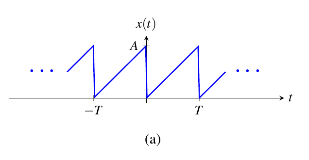
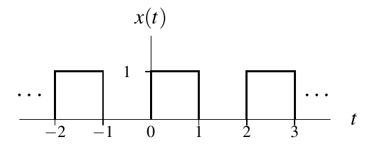
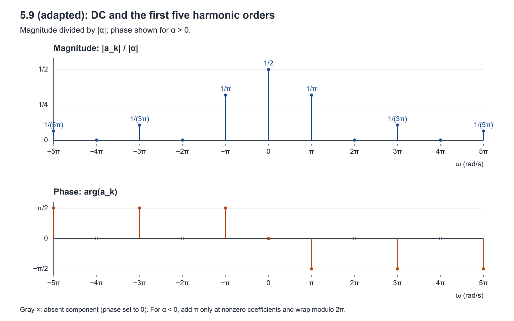
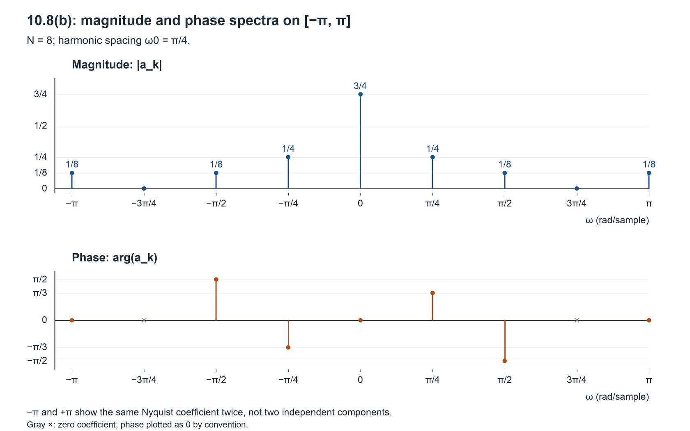

# ECE265 Tutorial 6

## Assignment 4: Fourier Series

T02 · Ruilin Wang

This file contains a recap, complete worked regular examples, and the MATLAB task statements with ideas and pseudocode for Assignment 4. References use **printed** pages from the slides and textbook, Edition **7.0.0-beta.3**.

For the lecture overview, see [Lecture Summary 5](../lecture_summeries/tutorial5lecture_summary.md), §§4-9 (CTFS, DTFS and the DFT), and [Lecture Summary 6](../lecture_summeries/tutorial6lecture_summary.md), §§1-5 (frequency spectra and real-signal symmetry). Summary 6 also covers Fourier series through LTI systems; that output-calculation method is not required for these Assignment 4 examples.

### Selected practice examples

| Assigned question(s) | Selected example | Main method |
| --- | --- | --- |
| 5.1(a) | 5.1(b) | Expand trigonometric products; read coefficients on one harmonic grid |
| 5.2(d) | 5.103(a) | Read a sawtooth graph; integrate over one period, using integration by parts |
| 5.3(a) | 5.3(b) | Apply impulse sifting; combine exponential terms into sine/cosine form |
| 10.1(c,d) | 10.1(a) | Apply DTFS analysis; simplify a finite geometric sum |
| 5.9 | Adapted 5.9 | Find CTFS coefficients and plot the spectrum; change pulse amplitude from 1 to $\alpha$ only |
| 10.8(a) | 10.8(b) | Read DTFS coefficients; combine repeated DT frequencies and plot magnitude/phase |
| 10.11(b,c) | 10.11(d) | Reorder coefficient indices modulo $N$, then convert DTFS coefficients to the DFT |

The examples are unassigned textbook parts except the explicitly adapted 5.9. Its period and pulse locations are unchanged. The assigned MATLAB questions are **10.204(a,b,c)** and **10.206(a,b,c)**.

**Coverage notes:** 5.3(b) does not demonstrate every opposite-sign impulse pair in 5.3(a), so the generic sine-pair identity appears in §3 below. 10.1(a) does not cover direct Euler-based coefficient reading in 10.1(c); 10.8(b) practises that method. It also does not demonstrate the $r=1$ case needed in 10.1(d); that case appears in §4.

**In class:** 5.103(a), 10.8(b), and 10.11(d), followed by the key parts of MATLAB 10.204 and 10.206. The remaining regular examples are for self-study or backup.

**Notation:** Original questions retain the textbook's coefficient symbol $c$ or $a$. In the solutions, $a_k$ follows the slides; it equals the textbook's $c_k$ where the question uses $c$.

## Recap

Use this section for preparation and self-study. In class, we start directly with examples.

### 1. Choose a harmonic grid before reading coefficients

For CT, choose a period $T>0$ and write $\omega_0=2\pi/T$. For DT, choose a positive-integer period $N$ and write $\omega_0=2\pi/N$. Every component must be expressed using the **same** $\omega_0$ before its coefficient can be read.

Useful identities are

$$
\cos\theta=\frac{e^{j\theta}+e^{-j\theta}}{2},
\qquad
\sin\theta=\frac{e^{j\theta}-e^{-j\theta}}{2j},
$$

$$
\cos u\sin v=\frac{\sin(v+u)+\sin(v-u)}{2},
\qquad
\sin^2u=\frac{1-\cos(2u)}{2}.
$$

**Method:** simplify products or powers first, convert the remaining sine/cosine terms into exponentials, then match each exponent to $jk\omega_0t$ or $jk\omega_0n$. The multiplier of that exponential is its coefficient. A constant term belongs to $k=0$.

For DT, a complex sinusoid at frequency $\omega$ has period $N$ when $\omega N=2\pi m$ for some integer $m$. Also,

$$
e^{j(k+N)\omega_0n}=e^{jk\omega_0n}.
$$

Thus DT terms whose harmonic indices differ by $N$ are the same basis sequence: **add their coefficients**, rather than storing them as independent terms. A common period need not be the fundamental period; if the question asks for the fundamental period, inspect the actual nonzero terms after simplification.

**Trap:** a cosine's real amplitude is not normally the height of each of its two complex-coefficient stems. See §5, including the DC and DT Nyquist exceptions.

**References:** slides pp. 146-150; textbook §§5.2-5.3, pp. 125-126, and §§10.2-10.3, pp. 439-442; Euler-based coefficient reading in Example 10.1, p. 442. Practice: 5.1(b), 10.8(b).

### 2. CTFS from a graph: write one period, then integrate

For a $T$-periodic CT function,

$$
\boxed{a_k=\frac{1}{T}\int_{t_0}^{t_0+T}x(t)e^{-jk\omega_0t}\thinspace dt,
\qquad\omega_0=\frac{2\pi}{T}.}
$$

**Method:** choose one convenient period, turn each graph segment into a formula, and split the integral at every formula change. On a straight segment through $(t_a,x_a)$ and $(t_b,x_b)$,

$$
x(t)=x_a+\frac{x_b-x_a}{t_b-t_a}(t-t_a),\qquad t_a\ne t_b.
$$

Calculate DC directly:

$$
\boxed{a_0=\frac{1}{T}\int_{t_0}^{t_0+T}x(t)\thinspace dt.}
$$

For nonzero $k$, a ramp segment introduces an integral of $t$ times an exponential. Use integration by parts,

$$
\int u\thinspace dv=uv-\int v\thinspace du,
$$

or the equivalent antiderivative

$$
\int te^{qt}\thinspace dt=e^{qt}\left(\frac{t}{q}-\frac{1}{q^2}\right)+C,
\qquad q\ne0.
$$

Here $q=-jk\omega_0$. Substitute both endpoints before simplifying. For integer $k$, $e^{-jk\omega_0T}=e^{-j2\pi k}=1$.

If the entire waveform is multiplied by $\alpha$, every coefficient is multiplied by $\alpha$ too. For magnitudes the multiplier is $\lvert\alpha\rvert$; a negative or complex nonzero multiplier can also change phase. Do not assume that phase is unchanged unless the multiplier is positive real.

**Trap:** do not put $k=0$ into an expression derived by dividing by $k$. Also retain the normalization $1/T$. Changing ordinary function values at isolated jump points does not change the coefficients; the Fourier series reconstructs the midpoint of a jump under the usual convergence conditions, not an arbitrarily assigned jump value.

**References:** slide pp. 148, 152, 155; textbook §5.3, pp. 126-128; Appendix E.4, Eq. (E.1) and integration by parts, p. 734; jump-point clarification in §5.4, p. 133. Practice: 5.103(a), adapted 5.9.

### 3. CTFS of periodic impulses: replace integration by sifting

If one period contains impulses with weights $B_r$ at locations $t_r$, then the analysis equation and sifting give

$$
\boxed{a_k=\frac{1}{T}\sum_{r=1}^{R}B_re^{-jk\omega_0t_r}.}
$$

This formula lists only the impulses in **one** period. Choose boundaries away from impulses when possible, so a repeated boundary impulse is not counted twice.

**Method:** keep each signed impulse weight, substitute its location into the negative exponential, then look for terms that can be paired. For two locations $p,q$,

$$
e^{-jk\omega_0p}+e^{-jk\omega_0q}
=2e^{-jk\omega_0(p+q)/2}\cos\left(\frac{k\omega_0(q-p)}{2}\right),
$$

$$
e^{-jk\omega_0p}-e^{-jk\omega_0q}
=2je^{-jk\omega_0(p+q)/2}\sin\left(\frac{k\omega_0(q-p)}{2}\right).
$$

Equal weights lead to the sum/cosine identity; opposite weights lead to the difference/sine identity. Factor out the common phase before applying the identity.

**Trap:** an impulse's weight is not its finite height. Do not replace sifting by an ordinary area estimate, drop the factor $1/T$, or lose the sign of an opposite-weight pair.

**References:** slide p. 148 (analysis equation); textbook §5.3, Examples 5.2-5.3, pp. 128-130. Practice: 5.3(b); the difference identity also supports assigned 5.3(a).

### 4. DTFS from one period: count samples and simplify the finite sum

For an $N$-periodic sequence,

$$
\boxed{a_k=\frac{1}{N}\sum_{n=n_0}^{n_0+N-1}x(n)e^{-j(2\pi/N)kn},
\qquad a_{k+N}=a_k.}
$$

The sum contains exactly $N$ consecutive integer indices. You may choose a different start, but keep each sample attached to its actual index in the exponential.

**Method:** substitute the one-period formula for $x(n)$, combine exponential factors, and identify a finite geometric sum. For a positive integer $M$,

$$
\boxed{\sum_{m=0}^{M-1}r^m=
\begin{cases}
\dfrac{1-r^M}{1-r},&r\ne1\cr
M,&r=1.
\end{cases}}
$$

If a sum starts at $n=L$, set $m=n-L$ and retain the factor $r^L$. The number of included integers from $L$ through $U$ is $U-L+1$.

**Trap:** test whether the ratio can equal 1 before dividing by $1-r$. A finite geometric sum does **not** require $\lvert r\rvert\lt1$. After finding one block of DTFS coefficients, state its $N$-periodic extension.

**References:** slides pp. 149-150; textbook §§10.2-10.3, pp. 439-442; Appendix E.5, Eq. (E.9), p. 734. Practice: 10.1(a); the $r=1$ branch is also needed for assigned 10.1(d).

### 5. From coefficients to magnitude and phase spectra

Each coefficient $a_k$ belongs at angular frequency $k\omega_0$. Plot its magnitude $\lvert a_k\rvert$ and phase $\arg(a_k)$ as separate stem plots when the coefficients are generally complex. Include DC if it is nonzero.

For real $x$,

$$
a_{-k}=(a_k)^{\ast},
\qquad
\lvert a_{-k}\rvert=\lvert a_k\rvert.
$$

At nonzero coefficients, the paired phases have opposite signs modulo $2\pi$. A zero coefficient has no meaningful phase; the textbook uses the plotting convention $\arg(0)=0$.

For two distinct opposite-frequency terms of a real signal,

$$
a_ke^{jk\omega_0\xi}+a_{-k}e^{-jk\omega_0\xi}
=2\lvert a_k\rvert\cos(k\omega_0\xi+\arg(a_k)).
$$

Here $\xi=t$ in CT and $\xi=n$ in DT. Thus a cosine of amplitude $A>0$ contributes two coefficient magnitudes $A/2$ when the two DT frequencies are distinct, or for nonzero CT frequency.

In DT, $a_{k+N}=a_k$ and frequencies repeat every $2\pi$. Normally show one baseband interval, $\lbrack-\pi,\pi)$ or $(-\pi,\pi\rbrack$. The frequencies $-\pi$ and $\pi$ are equivalent because

$$
e^{j\pi n}=e^{-j\pi n}=(-1)^n.
$$

For a real-valued DT signal, DC and, for even $N$, the Nyquist term at $k=N/2$ each have one real coefficient. Do not split either into two independent half-sized coefficients. If a question asks for a plot on the closed interval $\lbrack-\pi,\pi\rbrack$, showing the same coefficient at both endpoints illustrates repetition, not two independent components.

**Trap:** label the horizontal axis with frequency, not merely $k$; do not draw a continuous curve through line-spectrum stems. Keep the signed/complex coefficient until after calculating its magnitude and phase.

**References:** slides pp. 166-171; textbook §5.6, pp. 147-150, and §10.7, pp. 463-466; real cosine amplitudes in §5.5.10, p. 144, and §10.5.11, p. 458. Practice: adapted 5.9, 10.8(b).

### 6. DTFS to DFT: put the indices in order before scaling

For the same $N$-periodic sequence with the same mathematical index origin,

$$
\boxed{X(k)=Na_k,\qquad k=0,1,\ldots,N-1.}
$$

**Method:** attach the stated mathematical index to every given coefficient. Use $a_{k+N}=a_k$ to place those values into the order $a_0,a_1,\ldots,a_{N-1}$; only then multiply by $N$ to form the stored DFT vector.

The modulo operation maps an integer index $k$ to the representative $\mathrm{mod}(k,N)$ in $0,\ldots,N-1$. It changes the label within one coefficient period, not the coefficient value.

**Trap:** the first entry of a supplied vector is not necessarily $a_0$. Do not multiply an incorrectly ordered vector by $N$, or compute an FFT of coefficients that are already DTFS coefficients. No real-valued-signal assumption is needed for this conversion.

**References:** slides pp. 158-161; textbook §10.6, p. 461, and Example 10.8, pp. 461-463. Practice: 10.11(d); this indexing convention also matters in MATLAB 10.204.

### 7. MATLAB bridge: mathematical indices, harmonics and error

#### Mathematical indices are not array positions

A vector's first MATLAB position is 1, but the first stored sample may have any mathematical index. If its starting index is $n_s$, zero-based offset $p$ (MATLAB position $p+1$) represents

$$
n=n_s+p,\qquad p=0,\ldots,N-1.
$$

The same distinction applies to a vector of coefficients with a stated starting index. Changing a vector's mathematical starting index without rearranging its values can change the represented sequence; it is not merely a cosmetic relabeling.

The DFT uses the standard mathematical indices $0,\ldots,N-1$. MATLAB's `fft` computes the DFT, whereas the DTFS analysis equation has the additional factor $1/N$. `ifft` implements the inverse DFT, whose synthesis equation includes $1/N$. Track the represented indices and the normalization separately.

#### One real-signal harmonic may require two DFT entries

For real input, DFT coefficients obey the same conjugate pairing as DTFS coefficients:

$$
X(N-k)=(X(k))^{\ast},\qquad k=1,\ldots,N-1.
$$

For real input, there are $\lfloor N/2\rfloor+1$ harmonic groups when DC is counted as harmonic 0. Ordinary positive/negative-frequency partners form one group; DC and, for even $N$, Nyquist are each single-entry groups. A real-valued approximation must retain or remove both members of every ordinary conjugate pair together. **A count of harmonics is not a count of stored DFT entries.**

#### Measure approximation error over the same samples

For one period of original samples $x(n)$ and approximation $\widehat{x}(n)$, the root-mean-square error (**RMSE**) is

$$
\boxed{\mathrm{RMSE}=\sqrt{\frac{1}{N}\sum_{n=0}^{N-1}\lvert x(n)-\widehat{x}(n)\rvert^2}.}
$$

If $K$ of the $\lfloor N/2\rfloor+1$ harmonic groups are retained, the horizontal coordinate in a percentage plot is

$$
\text{percentage retained}=100\frac{K}{\lfloor N/2\rfloor+1}.
$$

Compare errors at the same retained-harmonic percentage. Do not rank audio files by appearance or assume a result before generating their curves.

**Trap:** discarding just one side of a conjugate pair generally produces a complex-valued reconstruction. Also, treating an audio file as one period does not mean it contains only one musical cycle; the complete file is imagined to repeat as a loop.

**References:** slides pp. 149-150, 158-161, 171; textbook §10.6, p. 461, §10.5.11, pp. 458-459, and the MATLAB task definitions in 10.204 and 10.206, pp. 481-482. The RMSE formula spells out the error measure requested in 10.206(b).

## 5.1(b): Problem

**Original textbook question, printed p. 158 (common stem and selected subpart):**

> For each case below, find the Fourier series representation (in complex exponential form) of the function $x$, explicitly identifying the fundamental period of $x$ and the Fourier-series coefficient sequence $c$.
>
> (b) $x(t)=\cos(4t)\sin(t)$; and

The final “and” connects this subpart to the next textbook subpart, which is not reproduced here. We write the coefficients as $a_k$ below, following the slides; they are the textbook's $c_k$.

### Knowledge points

- Products of trigonometric functions can be converted into a sum before finding Fourier coefficients.
- All exponential terms must use one common fundamental frequency $\omega_0=2\pi/T$.
- Once the expression has the form $\sum_k a_ke^{jk\omega_0t}$, the multiplier of each basis function is its coefficient.

**References:** slides pp. 146-148; textbook §§5.2-5.3, pp. 125-126; Euler-based coefficient reading and trigonometric forms in §5.5.10, pp. 143-144.

### Core bridge formula

$$
\cos u\sin v=\frac{\sin(v+u)+\sin(v-u)}{2},
\qquad
\sin\theta=\frac{e^{j\theta}-e^{-j\theta}}{2j}.
$$

Match the result to the CTFS synthesis equation

$$
x(t)=\sum_{k=-\infty}^{\infty}a_ke^{jk\omega_0t}.
$$

### Answer

**1. Replace the product by a sum.** Substitute $u=4t$ and $v=t$:

$$
x(t)=\frac{\sin(t+4t)+\sin(t-4t)}{2}
=\frac{1}{2}\sin(5t)+\frac{1}{2}\sin(-3t)
=\frac{1}{2}\sin(5t)-\frac{1}{2}\sin(3t).
$$

**2. Identify the fundamental period.** The two nonzero sinusoidal components have angular frequencies $5$ and $3$. A common period $P>0$ must satisfy

$$
5P=2\pi m,\qquad 3P=2\pi n
$$

for integers $m,n$. These equations give $3m=5n$, so $m=5q$, $n=3q$, and $P=2\pi q$ for a positive integer $q$. The smallest possibility is therefore

$$
\boxed{T=2\pi,\qquad\omega_0=\frac{2\pi}{2\pi}=1.}
$$

Both nonzero frequencies must be included; the product's fundamental period is not obtained by keeping only one factor's period.

**3. Convert both sine terms into exponentials.**

$$
\frac{1}{2}\sin(5t)=\frac{1}{4j}e^{j5t}-\frac{1}{4j}e^{-j5t},
$$

$$
-\frac{1}{2}\sin(3t)=-\frac{1}{4j}e^{j3t}+\frac{1}{4j}e^{-j3t}.
$$

Since $1/j=-j$, this becomes

$$
x(t)=-\frac{j}{4}e^{j5t}+\frac{j}{4}e^{-j5t}
+\frac{j}{4}e^{j3t}-\frac{j}{4}e^{-j3t}.
$$

**4. Read the coefficients using $\omega_0=1$.** For example, $e^{j5t}=e^{j(5)\omega_0t}$ belongs to $k=5$, and its multiplier is $-j/4$. The complete result is

$$
\boxed{
a_k=
\begin{cases}
-j/4,&k=5\cr
j/4,&k=-5\cr
j/4,&k=3\cr
-j/4,&k=-3\cr
0,&\text{otherwise},
\end{cases}
\qquad
x(t)=\sum_{k=-\infty}^{\infty}a_ke^{jkt}.
}
$$

There is no constant term, so $a_0=0$. The opposite-index coefficients are conjugates, as expected for real-valued $x$.

## 5.103(a): Problem

**Original textbook question, printed p. 161 (common stem and selected graph):**

> For each $T$-periodic function $x$ shown in the figures below, find the corresponding Fourier-series coefficient sequence $c$. (Some of the integrals listed in Section E.4 may be helpful for some parts of this exercise.)
>
> (a)



The graph's amplitude $A$ and period $T$ are kept symbolic. It shows a rise from $0$ to $A$ during each period, followed by a reset; $T>0$. The coefficients below are denoted $a_k$, equivalent to the question's $c_k$.

### Knowledge points

- Translate the graph into a function on one period before integrating.
- The CTFS analysis equation includes the factor $1/T$.
- Compute $a_0$ from the average value; use integration by parts for the ramp multiplied by an exponential when $k\ne0$.

**References:** slides pp. 148, 155; textbook §5.3, p. 126; Appendix E.4, Eq. (E.1) and integration by parts, p. 734.

### Core bridge formula

$$
a_k=\frac{1}{T}\int_{t_0}^{t_0+T}x(t)e^{-jk\omega_0t}\thinspace dt,
\qquad\omega_0=\frac{2\pi}{T},
$$

$$
a_0=\frac{1}{T}\int_{t_0}^{t_0+T}x(t)\thinspace dt,
\qquad
\int u\thinspace dv=uv-\int v\thinspace du.
$$

### Answer

**1. Write a formula on one period.** Choose $0\le t\lt T$. The rising line passes through $(0,0)$ and approaches $(T,A)$, so its slope is

$$
\frac{A-0}{T-0}=\frac{A}{T}.
$$

Consequently,

$$
x(t)=\frac{A}{T}t,\qquad0\le t\lt T,
\qquad x(t+T)=x(t).
$$

The value assigned at a reset does not affect the Fourier coefficients.

**2. Calculate the DC coefficient separately.**

$$
a_0=\frac{1}{T}\int_0^T\frac{A}{T}t\thinspace dt
=\frac{A}{T^2}\left\lbrack\frac{t^2}{2}\right\rbrack_0^T
=\frac{A}{T^2}\left(\frac{T^2}{2}-0\right)
=\frac{A}{2}.
$$

This agrees with the average height of the ramp.

**3. Set up the coefficient integral for $k\ne0$.**

$$
a_k=\frac{1}{T}\int_0^T\frac{A}{T}t\thinspace e^{-jk\omega_0t}\thinspace dt
=\frac{A}{T^2}\int_0^Tte^{-jk\omega_0t}\thinspace dt.
$$

Choose

$$
u=t,\qquad dv=e^{-jk\omega_0t}\thinspace dt,
\qquad du=dt,\qquad v=\frac{e^{-jk\omega_0t}}{-jk\omega_0}.
$$

Division by $-jk\omega_0$ is valid here because $k\ne0$ and $T>0$. Integration by parts gives

$$
\int_0^Tte^{-jk\omega_0t}\thinspace dt
=\left\lbrack\frac{te^{-jk\omega_0t}}{-jk\omega_0}\right\rbrack_0^T
-\frac{1}{-jk\omega_0}\int_0^Te^{-jk\omega_0t}\thinspace dt.
$$

Because $k$ is an integer,

$$
e^{-jk\omega_0T}=e^{-jk(2\pi/T)T}=e^{-j2\pi k}=1.
$$

The remaining exponential integral is therefore

$$
\int_0^Te^{-jk\omega_0t}\thinspace dt
=\left\lbrack\frac{e^{-jk\omega_0t}}{-jk\omega_0}\right\rbrack_0^T
=\frac{1-1}{-jk\omega_0}=0.
$$

The first boundary term is

$$
\left\lbrack\frac{te^{-jk\omega_0t}}{-jk\omega_0}\right\rbrack_0^T
=\frac{T(1)}{-jk\omega_0}-\frac{0(1)}{-jk\omega_0}
=-\frac{T}{jk\omega_0}.
$$

Substituting back,

$$
a_k=\frac{A}{T^2}\left(-\frac{T}{jk\omega_0}\right)
=-\frac{A}{jk\omega_0T}
=-\frac{A}{j2\pi k}
=\frac{jA}{2\pi k},\qquad k\ne0.
$$

**Final coefficient sequence:**

$$
\boxed{
a_k=\begin{cases}
A/2,&k=0\cr
\dfrac{jA}{2\pi k},&k\ne0.
\end{cases}}
$$

The period enters the harmonic frequencies through $\omega_0=2\pi/T$. Its cancellation from the coefficient values does not mean that the waveform's period has disappeared.

## 5.3(b): Problem

**Original textbook question, printed p. 159 (common stem and selected subpart):**

> Find the Fourier-series coefficient sequence $c$ of each periodic function $x$ given below with fundamental period $T$.
>
> (b) $x(t)=\delta(t)+6\delta(t-1)+6\delta(t-2)$ and $T=3$; express $c$ in terms of $\sin$ and $\cos$ to whatever extent is possible.

The listed impulses specify one period of the periodic impulse pattern; repeat that pattern every 3 units of time. We denote the coefficients by $a_k$ below, equivalent to the question's $c_k$.

### Knowledge points

- Apply the CTFS analysis equation over one period and use impulse sifting.
- An impulse contributes its signed weight multiplied by the analysis exponential evaluated at its location.
- Use integer-index exponential periodicity and Euler's identities to express the result in sine/cosine form.

**References:** slide p. 148; textbook §5.3, Examples 5.2-5.3, pp. 128-130.

### Core bridge formula

If one period contains impulses of weights $B_r$ at $t_r$,

$$
a_k=\frac{1}{T}\sum_{r=1}^{R}B_re^{-jk\omega_0t_r},
\qquad\omega_0=\frac{2\pi}{T}.
$$

The simplification uses

$$
e^{j\theta}+e^{-j\theta}=2\cos\theta,
\qquad e^{-j2\pi k}=1\quad(k\in\mathbb Z).
$$

### Answer

**1. Identify one period and its fundamental frequency.**

$$
T=3,\qquad\omega_0=\frac{2\pi}{3}.
$$

Choose the interval $-1/2\le t\lt5/2$, which has length 3. It contains exactly the impulses at $t=0,1,2$, none on a boundary, with weights $1,6,6$.

**2. Substitute each impulse into the analysis equation.**

$$
a_k=\frac{1}{3}\int_{-1/2}^{5/2}
\bigl(\delta(t)+6\delta(t-1)+6\delta(t-2)\bigr)
e^{-jk(2\pi/3)t}\thinspace dt.
$$

Sifting evaluates the exponential at each impulse's location:

$$
a_k=\frac{1}{3}\left(1e^{-jk(2\pi/3)(0)}
+6e^{-jk(2\pi/3)(1)}+6e^{-jk(2\pi/3)(2)}\right)
=\frac{1}{3}\left(1+6e^{-j2\pi k/3}+6e^{-j4\pi k/3}\right).
$$

**3. Turn the two equal-weight exponentials into a cosine.** Since $k$ is an integer,

$$
e^{-j4\pi k/3}
=e^{j2\pi k/3}e^{-j2\pi k}
=e^{j2\pi k/3}.
$$

Hence

$$
a_k=\frac{1}{3}\left(1+6e^{-j2\pi k/3}+6e^{j2\pi k/3}\right)
=\frac{1}{3}\left(1+6\left(2\cos\frac{2\pi k}{3}\right)\right).
$$

Therefore the complete coefficient sequence is

$$
\boxed{a_k=\frac{1}{3}+4\cos\left(\frac{2\pi k}{3}\right),\qquad k\in\mathbb Z.}
$$

#### Extra check (Optional): one coefficient period and DC

For one coefficient period, substitute $k=0,1,2$:

$$
a_0=\frac{1}{3}+4(1)=\frac{13}{3},
$$

$$
a_1=\frac{1}{3}+4\left(-\frac{1}{2}\right)=-\frac{5}{3},
\qquad
a_2=\frac{1}{3}+4\left(-\frac{1}{2}\right)=-\frac{5}{3}.
$$

Equivalently,

$$
\boxed{(a_0,a_1,a_2)=\left(\frac{13}{3},-\frac{5}{3},-\frac{5}{3}\right),\qquad a_{k+3}=a_k.}
$$

Here the CTFS coefficient sequence happens to repeat in $k$ because the impulses lie on an equally spaced grid. CTFS coefficient sequences are not periodic in general. The DC value also checks directly: the total impulse weight in one period divided by its length is $(1+6+6)/3=13/3$.

## 10.1(a): Problem

**Original textbook wording (p. 478):**

> Find the Fourier series representation of each sequence $x$ given below.
>
> (a) $x(n)=\left(\frac{1}{2}\right)^n$ for $n\in\lbrack0..7\rbrack$ and $x(n)=x(n+8)$;

### Knowledge points

- DTFS analysis and synthesis over exactly one period: slides pp. 149-150; textbook §§10.2-10.3, pp. 439-442.
- A finite geometric sum, including its $r=1$ exception: Appendix E.5, Eq. (E.9), p. 734.
- The coefficient sequence is $N$-periodic: slide p. 150.

### Core bridge formula

For an $N$-periodic sequence,

$$
a_k=\frac{1}{N}\sum_{n=0}^{N-1}x(n)e^{-j(2\pi/N)kn},
\qquad
x(n)=\sum_{k=0}^{N-1}a_ke^{j(2\pi/N)kn}.
$$

For a positive integer $M$,

$$
\sum_{n=0}^{M-1}r^n=
\begin{cases}
\dfrac{1-r^M}{1-r},&r\ne1\cr
M,&r=1.
\end{cases}
$$

### Answer

**1. Use the specified period.**

The values for $n=0,1,\ldots,7$ are

$$
\left(1,\frac12,\frac14,\frac18,\frac1{16},\frac1{32},\frac1{64},\frac1{128}\right),
$$

and the question repeats this block every 8 samples. Use

$$
N=8,\qquad\omega_0=\frac{2\pi}{8}=\frac{\pi}{4}.
$$

The value 1 occurs only at indices congruent to 0 modulo 8, so the fundamental period is also 8.

**2. Substitute the actual one-period values into the analysis equation.**

$$
a_k=\frac18\sum_{n=0}^{7}\left(\frac12\right)^n e^{-j(\pi/4)kn}
=\frac18\sum_{n=0}^{7}\left(\frac12 e^{-j\pi k/4}\right)^n.
$$

The ratio of this geometric sum is

$$
r=\frac12e^{-j\pi k/4}.
$$

Its magnitude is $\lvert r\rvert=1/2$, so $r$ cannot equal 1 for any integer $k$. There are eight terms, with powers 0 through 7. Therefore,

$$
a_k=\frac18\frac{1-\left(\frac12e^{-j\pi k/4}\right)^8}
{1-\frac12e^{-j\pi k/4}}.
$$

**3. Simplify the eighth power.**

Since $k$ is an integer,

$$
\left(\frac12e^{-j\pi k/4}\right)^8
=\frac1{256}e^{-j2\pi k}=\frac1{256}.
$$

Thus

$$
a_k=\frac18\frac{1-1/256}{1-\frac12e^{-j\pi k/4}}
=\frac18\frac{255/256}{1-\frac12e^{-j\pi k/4}}.
$$

**Final coefficient sequence:**

$$
\boxed{a_k=\frac{255}{2048\left(1-\frac12e^{-j\pi k/4}\right)},
\qquad k\in\mathbb Z,\qquad a_{k+8}=a_k.}
$$

This formula also covers $k=0$; its denominator does not vanish. In particular,

$$
a_0=\frac{255}{2048(1-1/2)}=\frac{255}{1024}.
$$

**Final Fourier-series representation:**

$$
\boxed{x(n)=\sum_{k=0}^{7}
\frac{255}{2048\left(1-\frac12e^{-j\pi k/4}\right)}
e^{j\pi kn/4},\qquad n\in\mathbb Z.}
$$

## 5.9 (adapted): Problem

**Original textbook question, printed p. 159; original figure on p. 160:**

> Find the Fourier-series coefficient sequence $c$ of the periodic function $x$ shown in the figure below. Plot the frequency spectrum of $x$, including the first five harmonics.



**Approved adaptation:** replace the figure's pulse height $1$ by the symbolic height $\alpha$ only. Keep the period $2$ and all pulse locations unchanged. The original figure above is reproduced unchanged; read its height label $1$ as $\alpha$ for our example. Here $\alpha$ is a real height, not a chosen numerical value; the answer below includes positive, negative and zero heights. We write $a_k=c_k$, as in the slides.

### Knowledge points

- Read one period of a rectangular waveform and apply the CTFS analysis equation.
- Calculate $a_0$ separately; use the parity of integer $k$ to simplify $(-1)^k$.
- Plot the complex coefficient's magnitude and phase at frequency $k\omega_0$, retaining DC and zero harmonics.

**References:** slides pp. 147-148, 152, 155, 166-170; textbook §5.3, pp. 126-128, and §5.6, pp. 147-150.

### Core bridge formula

$$
a_k=\frac{1}{T}\int_{t_0}^{t_0+T}x(t)e^{-jk\omega_0t}\thinspace dt,
\qquad\omega_0=\frac{2\pi}{T},
$$

$$
a_0=\frac{1}{T}\int_{t_0}^{t_0+T}x(t)\thinspace dt,
\qquad
\text{magnitude}=\lvert a_k\rvert,
\qquad
\text{phase}=\arg(a_k).
$$

The $K$th harmonic components occur at $\pm K\omega_0$. Thus the first five harmonic orders are $K=1,2,3,4,5$, whether or not a particular coefficient is zero. DC is shown in addition to those five orders.

### Answer

**1. Write one period of the adapted waveform.** Choose $0\le t\lt2$:

$$
x(t)=\begin{cases}
\alpha,&0\le t\lt1\cr
0,&1\le t\lt2,
\end{cases}
\qquad x(t+2)=x(t).
$$

We use

$$
T=2,\qquad\omega_0=\frac{2\pi}{2}=\pi.
$$

For $\alpha\ne0$, this is the fundamental period. For $\alpha=0$, the waveform is zero everywhere; $T=2$ remains a valid chosen period, although the zero waveform has no smallest positive period.

**2. Find DC.** The signal is nonzero for one unit of the two-unit period:

$$
a_0=\frac{1}{2}\left(\int_0^1\alpha\thinspace dt+\int_1^2 0\thinspace dt\right)
=\frac{1}{2}\left(\alpha(1-0)+0\right)
=\boxed{\frac{\alpha}{2}}.
$$

**3. Integrate for nonzero $k$.**

$$
a_k=\frac{1}{2}\int_0^2x(t)e^{-jk\pi t}\thinspace dt
=\frac{\alpha}{2}\int_0^1e^{-jk\pi t}\thinspace dt,
\qquad k\ne0.
$$

The antiderivative is $e^{-jk\pi t}/(-jk\pi)$, so

$$
a_k=\frac{\alpha}{2}\left\lbrack\frac{e^{-jk\pi t}}{-jk\pi}\right\rbrack_0^1
=\frac{\alpha}{2}\frac{e^{-jk\pi}-1}{-jk\pi}
=\frac{\alpha\bigl(1-e^{-jk\pi}\bigr)}{2j\pi k}.
$$

For integer $k$, $e^{-jk\pi}=(-1)^k$. Therefore

$$
a_k=\frac{\alpha\bigl(1-(-1)^k\bigr)}{2j\pi k},\qquad k\ne0.
$$

- If $k$ is even and nonzero, $(-1)^k=1$, so the numerator is $\alpha(1-1)=0$.
- If $k$ is odd, $(-1)^k=-1$, so the numerator is $\alpha(1-(-1))=2\alpha$.

For odd $k$, $1/j=-j$ gives

$$
a_k=\frac{2\alpha}{2j\pi k}=\frac{\alpha}{j\pi k}=-\frac{j\alpha}{\pi k}.
$$

The complete coefficient sequence is

$$
\boxed{a_k=\begin{cases}
\alpha/2,&k=0\cr
-\dfrac{j\alpha}{\pi k},&k\text{ odd}\cr
0,&k\ne0\text{ even}.
\end{cases}}
$$

**4. Take magnitudes and phases.** For nonzero odd $k$,

$$
\left\lvert-\frac{j\alpha}{\pi k}\right\rvert
=\frac{\lvert j\rvert\lvert\alpha\rvert}{\pi\lvert k\rvert}
=\frac{\lvert\alpha\rvert}{\pi\lvert k\rvert}.
$$

For $\alpha\ne0$, let $\phi_\alpha=\arg(\alpha)$: it is $0$ for positive $\alpha$ and $\pi$ for negative $\alpha$. Positive odd $k$ gives $-j$ times $\alpha$; negative odd $k$ gives $+j$ times $\alpha$. Consequently,

$$
\arg(a_k)\equiv\begin{cases}
\phi_\alpha,&k=0\cr
\phi_\alpha-\pi/2,&k>0\text{ odd}\cr
\phi_\alpha+\pi/2,&k\lt0\text{ odd}
\end{cases}\pmod{2\pi}.
$$

At zero coefficients, show phase $0$ by the textbook's plotting convention; it does not indicate a nonzero component.

**5. Substitute the first five harmonic orders and plot.** The following table assumes $\alpha\ne0$; phase values are understood modulo $2\pi$.

| $k$ | Frequency $k\omega_0$ | Coefficient $a_k$ | Magnitude $\lvert a_k\rvert$ | Phase |
| --- | --- | --- | --- | --- |
| $-5$ | $-5\pi$ | $j\alpha/(5\pi)$ | $\lvert\alpha\rvert/(5\pi)$ | $\phi_\alpha+\pi/2$ |
| $-4$ | $-4\pi$ | $0$ | $0$ | $0$ by convention |
| $-3$ | $-3\pi$ | $j\alpha/(3\pi)$ | $\lvert\alpha\rvert/(3\pi)$ | $\phi_\alpha+\pi/2$ |
| $-2$ | $-2\pi$ | $0$ | $0$ | $0$ by convention |
| $-1$ | $-\pi$ | $j\alpha/\pi$ | $\lvert\alpha\rvert/\pi$ | $\phi_\alpha+\pi/2$ |
| $0$ | $0$ | $\alpha/2$ | $\lvert\alpha\rvert/2$ | $\phi_\alpha$ |
| $1$ | $\pi$ | $-j\alpha/\pi$ | $\lvert\alpha\rvert/\pi$ | $\phi_\alpha-\pi/2$ |
| $2$ | $2\pi$ | $0$ | $0$ | $0$ by convention |
| $3$ | $3\pi$ | $-j\alpha/(3\pi)$ | $\lvert\alpha\rvert/(3\pi)$ | $\phi_\alpha-\pi/2$ |
| $4$ | $4\pi$ | $0$ | $0$ | $0$ by convention |
| $5$ | $5\pi$ | $-j\alpha/(5\pi)$ | $\lvert\alpha\rvert/(5\pi)$ | $\phi_\alpha-\pi/2$ |

For example, $k=3$ gives $\omega=3\pi$ and $a_3=-j\alpha/(3\pi)$; $k=4$ is an even nonzero index, so $a_4=0$. The zero coefficients at orders 2 and 4 must not be skipped when identifying the first five harmonic orders.



The magnitude plot is normalized by $\lvert\alpha\rvert$: multiply its heights by $\lvert\alpha\rvert$ to obtain the actual magnitudes. Its phase panel is for **$\alpha>0$**. If $\alpha\lt0$, add $\pi$ to the phase at each **nonzero** coefficient and wrap modulo $2\pi$; zero-coefficient phase markers remain $0$ by convention. If $\alpha=0$, every coefficient and magnitude is zero, and all phase markers may be set to zero by convention; do not use the normalized magnitude plot for that case.

## 10.8(b): Problem

**Original textbook wording (p. 479):**

> Find and plot the magnitude and phase spectra of each sequence $x$ given below for frequencies in $\lbrack-\pi,\pi\rbrack$.
>
> (b) $x(n)=\frac34+\frac12\cos\left(\frac\pi4n+\frac\pi3\right)+\frac14\sin\left(\frac\pi2n\right)+\frac18\cos(\pi n)$; and

### Knowledge points

- DTFS synthesis and repeated basis sequences: slides pp. 146, 149-150; textbook §10.2, p. 439.
- Read coefficients after applying Euler's relations: textbook Example 10.1, p. 442.
- Magnitude/phase line spectra and DT baseband repetition: slides pp. 166-169; textbook §10.7, pp. 463-466.
- For real sequences, DC and the even-$N$ Nyquist component are each represented once: slide p. 171; textbook §10.5.11, pp. 458-459.

### Core bridge formula

$$
\cos\theta=\frac{e^{j\theta}+e^{-j\theta}}2,
\qquad
\sin\theta=\frac{e^{j\theta}-e^{-j\theta}}{2j}.
$$

Match the expanded terms to the DTFS synthesis form

$$
x(n)=\sum_{k=0}^{N-1}a_ke^{j(2\pi/N)kn},\qquad a_{k+N}=a_k.
$$

Place coefficient $a_k$ at frequency $k\omega_0$, where $\omega_0=2\pi/N$. Its magnitude and phase are the heights on the two corresponding stem plots. Terms with the same index modulo $N$ must be combined.

### Answer

**1. Choose one common harmonic grid.**

The three nonconstant terms have periods 8, 4 and 2. Use their least common multiple:

$$
N=\mathrm{lcm}(8,4,2)=8,\qquad\omega_0=\frac{2\pi}{8}=\frac\pi4.
$$

Their frequencies are $\omega_0$, $2\omega_0$ and $4\omega_0$.

**2. Expand the cosine with its phase retained.**

$$
\frac12\cos\left(\frac\pi4n+\frac\pi3\right)
=\frac12\frac{e^{j(\pi n/4+\pi/3)}+e^{-j(\pi n/4+\pi/3)}}2
$$

$$
=\frac14e^{j\pi/3}e^{j\pi n/4}
+\frac14e^{-j\pi/3}e^{-j\pi n/4}.
$$

Thus the $k=1$ and $k=-1$ coefficients are $e^{j\pi/3}/4$ and $e^{-j\pi/3}/4$, respectively. Their magnitudes are both $1/4$, not $1/2$.

**3. Expand the sine, including the sign of $1/j$.**

$$
\frac14\sin\left(\frac\pi2n\right)
=\frac1{8j}e^{j\pi n/2}-\frac1{8j}e^{-j\pi n/2}
=-\frac j8e^{j\pi n/2}+\frac j8e^{-j\pi n/2}.
$$

Therefore $a_2=-j/8$ and $a_{-2}=j/8$. Their phases are $-\pi/2$ and $\pi/2$, respectively.

**4. Combine the two Nyquist exponentials before reading the coefficient.**

For integer $n$,

$$
e^{j\pi n}=e^{-j\pi n}=(-1)^n.
$$

Hence

$$
\frac18\cos(\pi n)
=\frac1{16}e^{j\pi n}+\frac1{16}e^{-j\pi n}
=\left(\frac1{16}+\frac1{16}\right)e^{j\pi n}
=\frac18e^{j\pi n}.
$$

Here $k=4$ and $k=-4$ are the same class modulo 8. There is one coefficient $a_4=1/8$, not two independent coefficients of $1/16$.

**5. Collect a complete coefficient period.**

The DC term gives $a_0=3/4$. The remaining unlisted classes $k=3,5$ have no terms, so their coefficients are zero. Map negative indices using $a_{-1}=a_7$ and $a_{-2}=a_6$:

$$
\boxed{(a_0,a_1,a_2,a_3,a_4,a_5,a_6,a_7)
=\left(\frac34,\frac14e^{j\pi/3},-\frac j8,0,
\frac18,0,\frac j8,\frac14e^{-j\pi/3}\right),\qquad a_{k+8}=a_k.}
$$

**6. Convert the coefficients into the requested magnitude and phase plots.**

The requested interval includes both endpoints. The first and last rows below repeat the same Nyquist coefficient. Zero coefficients are shown with phase 0 using the textbook's plotting convention.

| Harmonic index $k$ | Frequency $\omega=k\pi/4$ | Coefficient $a_k$ | Magnitude $\lvert a_k\rvert$ | Phase $\arg(a_k)$ |
| --- | --- | --- | --- | --- |
| $-4$ | $-\pi$ | $1/8$ | $1/8$ | $0$ |
| $-3$ | $-3\pi/4$ | $0$ | $0$ | $0$ (convention) |
| $-2$ | $-\pi/2$ | $j/8$ | $1/8$ | $\pi/2$ |
| $-1$ | $-\pi/4$ | $e^{-j\pi/3}/4$ | $1/4$ | $-\pi/3$ |
| $0$ | $0$ | $3/4$ | $3/4$ | $0$ |
| $1$ | $\pi/4$ | $e^{j\pi/3}/4$ | $1/4$ | $\pi/3$ |
| $2$ | $\pi/2$ | $-j/8$ | $1/8$ | $-\pi/2$ |
| $3$ | $3\pi/4$ | $0$ | $0$ | $0$ (convention) |
| $4$ | $\pi$ | $1/8$ | $1/8$ | $0$ |



The horizontal axis is angular frequency in radians per sample. The magnitude spectrum is even, and the paired nonzero phases have opposite signs, as expected for this real-valued sequence. Showing the full coefficient at both $-\pi$ and $\pi$ illustrates spectral repetition; it does not double the component in the synthesis sum.

## 10.11(d): Problem

**Original textbook wording (p. 480):**

> For each $N$-periodic sequence $x$ with Fourier-series coefficient sequence $a$ given below, determine the DFT $X$ of $x$.
>
> (d) $(a_{-12},a_{-11},\ldots,a_{-5})=(3j,2+3j,-2+9j,6+3j,-8-9j,2+3j,10-7j,6+3j)$ and $N=8$.

### Knowledge points

- DTFS coefficients repeat every $N$ indices: slide p. 150; textbook §10.3, p. 441.
- The stored DFT has indices $0,\ldots,N-1$, with $X(k)=Na_k$: slides pp. 158-161; textbook §10.6, p. 461.
- Reorder a nonzero-start coefficient block before applying the scale factor: textbook Example 10.8, pp. 461-463.

### Core bridge formula

$$
\boxed{a_{k+N}=a_k,\qquad X(k)=Na_k\quad(k=0,\ldots,N-1).}
$$

If a given coefficient has index $q$, find the equivalent stored index $k=\mathrm{mod}(q,N)$. Place its value in position $a_k$ first, then multiply by $N$. The DFT here is the DFT **of $x$**, not a new DFT of the coefficient vector $a$.

### Answer

**1. Identify the period and output order.**

Here $N=8$, so the requested vector must be ordered as

$$
(X(0),X(1),\ldots,X(7)).
$$

The given first entry is $a_{-12}$, not $a_0$. Multiplying the supplied list by 8 without reordering would therefore put the right values in the wrong output positions.

**2. Reduce each original index modulo 8.**

Adding a multiple of 8 does not change a coefficient value:

| Original index $q$ | Given $a_q$ | Equivalent index in $0,\ldots,7$ | Correctly placed coefficient |
| --- | --- | --- | --- |
| $-12$ | $3j$ | $-12+16=4$ | $a_4=3j$ |
| $-11$ | $2+3j$ | $-11+16=5$ | $a_5=2+3j$ |
| $-10$ | $-2+9j$ | $-10+16=6$ | $a_6=-2+9j$ |
| $-9$ | $6+3j$ | $-9+16=7$ | $a_7=6+3j$ |
| $-8$ | $-8-9j$ | $-8+8=0$ | $a_0=-8-9j$ |
| $-7$ | $2+3j$ | $-7+8=1$ | $a_1=2+3j$ |
| $-6$ | $10-7j$ | $-6+8=2$ | $a_2=10-7j$ |
| $-5$ | $6+3j$ | $-5+8=3$ | $a_3=6+3j$ |

Read these placed values in increasing order of the **new** index:

$$
(a_0,a_1,\ldots,a_7)
=(-8-9j,2+3j,10-7j,6+3j,3j,2+3j,-2+9j,6+3j).
$$

**3. Multiply every correctly ordered entry by $N=8$.**

| $k$ | Numerical substitution $X(k)=8a_k$ | Result |
| --- | --- | --- |
| $0$ | $8(-8-9j)$ | $-64-72j$ |
| $1$ | $8(2+3j)$ | $16+24j$ |
| $2$ | $8(10-7j)$ | $80-56j$ |
| $3$ | $8(6+3j)$ | $48+24j$ |
| $4$ | $8(3j)$ | $24j$ |
| $5$ | $8(2+3j)$ | $16+24j$ |
| $6$ | $8(-2+9j)$ | $-16+72j$ |
| $7$ | $8(6+3j)$ | $48+24j$ |

**Final DFT, in its required stored order:**

$$
\boxed{(X(0),X(1),\ldots,X(7))
=(-64-72j,16+24j,80-56j,48+24j,
24j,16+24j,-16+72j,48+24j).}
$$

No FFT calculation is needed: the Fourier-series coefficients are already given, so periodic reindexing and the factor 8 complete the conversion.

## MATLAB 10.204: Problem

**Original question, textbook p. 481:**

> This exercise considers the development of a MATLAB function that computes one period of the DTFS coefficient sequence of an $N$-periodic sequence. The function takes the following parameters (in order):
>
> - `x`: a vector containing $N$ consecutive elements (i.e., one period) of the input sequence
> - `x_start`: the sequence index of the first element in the vector `x`
> - `y_start`: the sequence index of the first element in the vector `y` to be returned
>
> The function returns a vector `y` containing $N$ consecutive elements of the DTFS coefficient sequence starting at index `y_start`.
>
> (a) Develop a function `dtfs_1` with the interface described above that computes its result directly using the DTFS analysis equation (i.e., without using MATLAB functions like `fft`).
>
> (b) Develop a function `dtfs_2` with the interface described above that computes its result by leveraging MATLAB's `fft` function. [Hint: The `circshift` function is likely to be helpful.]
>
> (c) Determine the result returned by each function for each of the following sets of `x`, `x_start`, and `y_start` values:
>
> - `[10 4 -6 4], 0, 0`
> - `[10 4 -6 4], 0, 1`
> - `[4 10 4 -6], 1, 0`
> - `[4 10 4 -6], 1, 1`

### Knowledge points

- DTFS analysis over any $N$ consecutive samples: slides pp. 149-150; textbook §§10.2-10.3, pp. 439-442.
- DTFS coefficient periodicity, standard DFT order and the factor $N$: slides pp. 158-161; textbook §10.6, p. 461.
- Sample indices versus MATLAB positions: recap §7 and the meanings of `x_start` and `y_start` in the original question.

### Core bridge formula

Let $n_s$ denote `x_start` and $k_s$ denote `y_start`. Use zero-based **offsets** $p,q=0,\ldots,N-1$ in the following mathematical description; MATLAB array positions are $p+1$ and $q+1$.

The input's offset $p$ represents mathematical sample index $n_s+p$, and the output's offset $q$ must represent coefficient index $k_s+q$. The coefficient to store at output position $q+1$ is therefore

$$
a_{k_s+q}
=\frac{1}{N}\sum_{p=0}^{N-1}x(n_s+p)
e^{-j(2\pi/N)(k_s+q)(n_s+p)}.
$$

For a time-domain vector placed in mathematical order $x(0),\ldots,x(N-1)$, the DFT gives

$$
X(k)=\sum_{n=0}^{N-1}x(n)e^{-j(2\pi/N)kn},
\qquad a_k=\frac{X(k)}{N}.
$$

### Idea

**Part (a): translate the equation directly.** For each requested coefficient index, sum the $N$ weighted samples and divide by $N$. Both starts belong inside the exponential through their mathematical indices; neither start is a MATLAB position.

**Part (b): separate ordering from normalization.** First place the samples in the standard order corresponding to mathematical indices $0,\ldots,N-1$. Then use `fft` and the $1/N$ DTFS normalization. Finally read the coefficient period in the requested output order starting at `y_start`. Periodicity permits all index wrapping modulo $N$.

Do not simply feed an arbitrarily labeled vector into `fft` and assume its first value represents $x(0)$. Likewise, the first value of the returned vector must be $a_{k_s}$, not necessarily $a_0$.

### Pseudocode for 10.204(a)

```text
INPUT: one-period vector x, mathematical starts n_s and k_s
N = number of input samples

For each output offset q from 0 through N-1:
    requested coefficient index k = k_s + q
    total = 0
    For each input offset p from 0 through N-1:
        actual sample index n = n_s + p
        Add input value at offset p times exp(-j*2*pi*k*n/N) to total
    Store total/N at output offset q

RETURN the N coefficients in this requested order
```

### Pseudocode for 10.204(b)

```text
INPUT: one-period vector x, mathematical starts n_s and k_s
N = number of input samples

For each input offset p from 0 through N-1:
    actual sample index n = n_s + p
    Place that value at standard time index mod(n, N)

Compute the FFT of the standard-time-order vector
Divide all FFT values by N to obtain one standard-order DTFS period

For each output offset q from 0 through N-1:
    requested coefficient index k = k_s + q
    Read the standard-order coefficient at mod(k, N)
    Store it at output offset q

RETURN the N coefficients in this requested order
```

The placements above describe mathematical indices $0,\ldots,N-1$; an implementation must convert these to MATLAB positions $1,\ldots,N$. `circshift` can implement the periodic reordering without explicit placement loops.

### Plan for 10.204(c)

For each of the four original input triples:

1. Label the supplied samples with their actual sequence indices.
2. Run both methods and label the returned coefficients with the requested indices.
3. Compare the two complex-valued vectors, allowing only small floating-point roundoff differences.

The first and third triples must not be assumed to describe the same mathematical sequence. Starting the first sequence at index 1 would list `[4 -6 4 10]`, not the third triple's `[4 10 4 -6]`. Attach the given values to their stated indices and let the analysis equation determine the result.

## MATLAB 10.206: Problem

**Original question, textbook pp. 481-482:**

> An $N$-periodic sequence can be represented exactly by its $N$ DFT coefficients. In the case of a real-valued sequence, these coefficients correspond to $\lfloor N/2\rfloor+1$ harmonics, numbered $\lbrack0..\lfloor N/2\rfloor\rbrack$, where harmonic 0 is the DC (i.e., constant) component. In practice, many sequences have most of their energy concentrated in a small number of harmonics, so discarding the weakest harmonics introduces only a small error. This idea can be exploited in order to provide a crude form of data compression. Rather than storing all $N$ DFT coefficients to characterize a sequence, one can store only the few coefficients associated with the harmonics that carry most of the sequence's energy, achieving a compact approximate representation.
>
> (a) Write a MATLAB function `compress_sequence` that approximates a periodic sequence by retaining only a specified number of its strongest harmonics. The function should have the following signature:
>
> ```matlab
> function y = compress_sequence(x, num_harmonics)
> ```
>
> The function parameters are defined as follows:
>
> - `x`: a vector containing the samples from the period of the sequence with indices $\lbrack0..N-1\rbrack$;
> - `num_harmonics`: the number of harmonics (including the 0th harmonic) to be retained.
>
> The return value is defined as follows:
>
> - `y`: a vector containing the samples of the approximated sequence with indices $\lbrack0..N-1\rbrack$.
>
> The function should compute the DFT of `x`, determine which `num_harmonics` harmonics have the largest magnitude, zero the DFT coefficients of all remaining harmonics, and compute the inverse DFT to obtain the approximated sequence. Use MATLAB's `fft` and `ifft` functions.
>
> (b) Write a MATLAB function `analyze_compressibility` that analyzes how the approximation error varies with the percentage of harmonics retained. The function should have the following signature:
>
> ```matlab
> function analyze_compressibility(path)
> ```
>
> The function parameter is defined as follows:
>
> - `path`: the path to a WAV audio file (e.g., `audio.wav`).
>
> Since the signal from the audio file can be imagined as being played in a loop, it is reasonable to treat the samples in the audio file as one period of a periodic sequence. The function should plot the RMSE between the original and approximated sequences (as produced by `compress_sequence`) as a function of the percentage of harmonics retained, using enough points to produce a smooth plot.
>
> (c) Generate plots using the function from the previous part for the files `LDFlute_susNV_C4_v1_1.wav` and `drums.wav`. Determine which signal can be more accurately approximated using fewer harmonics, and explain very briefly why.

### Knowledge points

- A small set of strong Fourier-series terms can approximate a signal: slides pp. 164-165; textbook §5.6, Example 5.8, pp. 147-148. They illustrate the same principle, but the slide's printed numerical coefficients differ from the textbook example, as noted in Lecture Summary 6.
- Real-signal conjugate pairs, independent harmonics and DC/Nyquist: slides pp. 170-171; textbook §10.5.11, pp. 457-459.
- DFT and inverse DFT: slides pp. 160-161; textbook §10.6, p. 461.
- The error measure and percentage plot required by the original task: textbook 10.206(b), p. 482; recap §7.

### Core bridge formula

For a real-valued $N$-sample period, the number of harmonic groups is

$$
G=\left\lfloor\frac{N}{2}\right\rfloor+1.
$$

For $k=1,\ldots,N-1$,

$$
X(N-k)=(X(k))^{\ast}.
$$

Harmonic 0 is represented by $X(0)$ alone. If $N$ is even, harmonic $N/2$ is represented by $X(N/2)$ alone. Each other harmonic numbered between 1 and $\lfloor N/2\rfloor$ contains the **pair** of indices $k$ and $N-k$.

For an approximation $y$ reconstructed from selected harmonics,

$$
y(n)=\frac{1}{N}\sum_{k=0}^{N-1}\widetilde{X}(k)e^{j(2\pi/N)kn},
$$

where $\widetilde{X}$ contains the retained original DFT coefficients and zeros elsewhere. Its error is

$$
\mathrm{RMSE}=\sqrt{\frac{1}{N}\sum_{n=0}^{N-1}\lvert x(n)-y(n)\rvert^2}.
$$

Retaining $K$ harmonic groups gives the percentage

$$
\text{percentage retained}=100\frac{K}{G}.
$$

### Idea for 10.206(a)

Compute the DFT once for the input vector. Inspect its nonnegative harmonic representatives $k=0,\ldots,\lfloor N/2\rfloor$, and rank those harmonic representatives by their coefficient magnitudes $\lvert X(k)\rvert$, as part (a) specifies. Keep the selected $K$ harmonic groups and reconstruct by inverse DFT.

For an ordinary selected harmonic, retain both $X(k)$ and $X(N-k)$. DC and an even-$N$ Nyquist harmonic each have only one entry. Selecting $K$ harmonics therefore does not generally mean keeping only $K$ DFT entries.

**Counting convention used here:** the parenthetical "(including the 0th harmonic)" is read here as "harmonic 0 counts toward `num_harmonics`", not as "always keep DC". Harmonic 0 participates in the magnitude ranking and counts toward $K$ if selected; it is not a free extra coefficient.

Do not silently replace coefficient-magnitude ranking with summed conjugate-pair energy ranking: a pair has two entries, whereas DC and Nyquist each have one, so those rankings need not agree.

### Pseudocode for 10.206(a)

```text
INPUT: one real-valued period x and the number K of harmonic groups to retain
N = number of samples
G = floor(N/2) + 1
Use an integer K between 0 and G

Compute the DFT X using FFT
List harmonic representatives k = 0 through floor(N/2)
Rank the representatives by magnitude of X(k), from largest to smallest
Select the first K representatives
Create a length-N DFT vector filled with zeros

For each selected representative k:
    Copy the original coefficient X(k) into its position
    If k is neither DC nor the even-N Nyquist index:
        Also copy the original coefficient X(N-k) into its paired position

Apply inverse FFT to the retained-coefficient vector
RETURN the reconstructed N-sample approximation
```

For the boundary choice $K=0$, the selected set is empty and the approximation is zero. The reconstruction is real in exact arithmetic because the retained coefficients preserve conjugate symmetry. Small imaginary roundoff in a numerical inverse FFT is different from a substantial imaginary part caused by incorrectly removing one member of a pair.

### Idea for 10.206(b)

Treat the complete WAV sample vector as one period, not as a single musical cycle. Choose enough distinct integer harmonic counts to show the error trend across the available range. For each count, call the compression function and compare its returned samples with the corresponding original samples.

The horizontal axis is **percentage of harmonic groups retained**, not percentage of individual DFT entries. The vertical axis is RMSE over all $N$ corresponding samples. Include the full-retention point: keeping all $G$ groups should reconstruct the input up to roundoff.

The compression function's input is one vector. In the companion copies checked for this tutorial, the flute file has two channels and the drums file has one. Choose and document a channel-handling rule before passing a sample vector to the compression function, and apply it consistently; the original question does not prescribe averaging channels.

### Pseudocode for 10.206(b)

```text
INPUT: path to an audio WAV file
Read its samples as the vector to be analyzed
N = number of samples in that vector
G = floor(N/2) + 1

Choose sufficiently many distinct integer counts K from 0 through G
Include the endpoints 0 and G

For each chosen K:
    y = approximation returned by compress_sequence for x and K
    Compute the sample-by-sample difference between x and y
    Compute RMSE from those N differences
    Record horizontal coordinate 100*K/G and the RMSE

Plot RMSE (vertical) against the recorded percentages (horizontal)
Label both axes and identify the input file
```

The attainable percentages are discrete because $K$ is an integer. A smooth-looking plot uses enough such points; it does not require fractional harmonics. The zero-harmonic endpoint is a useful boundary case: it compares the input with the zero approximation.

### Plan for 10.206(c)

Apply the same analysis to the two **specified** WAV files. Compare their error curves using retained-harmonic percentages: reaching a small error at a lower retained percentage indicates a more compact approximation. The files have different lengths, so equal percentages do not mean equal numbers of harmonic groups.

Use the measured curves to support the conclusion. A signal dominated by a few strong harmonic components can often be represented with fewer groups than one whose content is spread across many frequencies, but do not announce a flute-versus-drums result before producing and checking these particular plots. Raw RMSE also scales with loudness: judge how small an error is relative to that file's own $K=0$ error, which equals its root-mean-square level. Still plot the requested raw RMSE rather than silently replacing it with a normalized error.

**Sources and figure credits:** Original question wording and the two source-figure crops are from Michael D. Adams, *Signals and Systems*, Edition 7.0.0-beta.3, © 2012-2026 Michael D. Adams. The sole changed-data question is explicitly labeled 5.9 (adapted). Spectrum illustrations are calculated for this tutorial. Knowledge references use the unified lecture slides and textbook of the same edition; assignment scope is from the handout Version 2026-09-21, Assignment 4.
